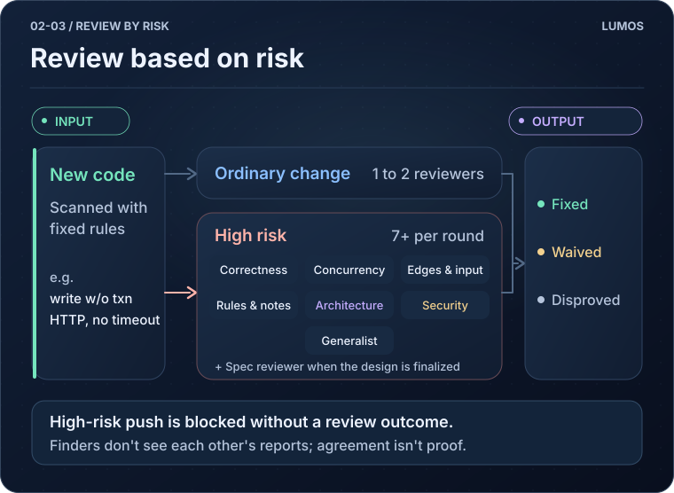
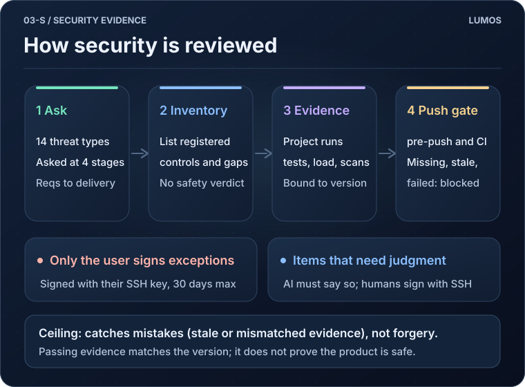
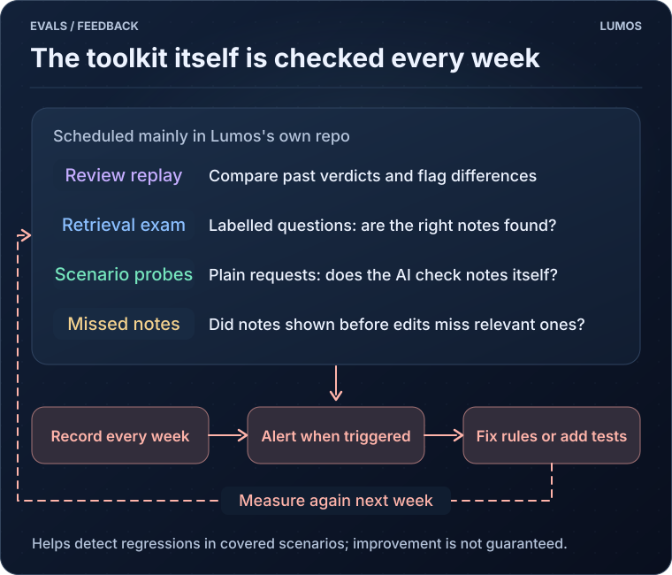

<p align="center">
  <picture>
    <source media="(prefers-color-scheme: dark)" srcset="assets/lumos-logo-dark.png">
    
  </picture>
</p>

# Lumos

[繁體中文](README.md) · **English**

[](https://github.com/EnzoHsieh-Android/Lumos/actions/workflows/ci.yml)

**When AI writes your code, have it record the reasoning too.**

Lumos is built for natural-language development: you describe what you need, and AI proposes and implements a solution, without being tied to one programming language. It adds a layer of control and records—a harness—to address five problems: opaque work, lost context, stale notes, hard-to-verify results, and increasingly messy architecture. The goal is to keep people in control without reading every diff line by line, so they can delegate more development to AI and advance several projects at once.

Coding through conversation is fast, but trade-offs and rejected options stay in that conversation. Reopen it, and the context is there. Three months later, when someone edits the same file, nobody remembers which conversation it was; teammates and other AI tools cannot see it either. Code may check that "an order must never be refunded twice" without explaining why the check must stay. AI says the tests passed, but afterward you cannot tell which ones it ran.

Lumos keeps that context in the project. Working with Claude Code or Codex, it does three things:

- **Makes AI keep records**: For each code change, AI records the reasons, the rules to preserve, and how it was verified, in Markdown notes versioned alongside the code, so anyone using any tool can find them.
- **Checks automatically at commit and push**: Git hooks check what can be automated, such as whether notes were updated. For code quality, it uses each language's existing linters and community rules and blocks only new warnings before a push.
- **Assigns AI reviewers by risk**: Reviewers examine changes from several angles, and Lumos confirms that tests actually ran and can catch problems.

Think of three familiar tools combined to check AI's work: ADRs (architecture decision records) keep decisions, CODEOWNERS says who owns each file, and pre-commit checks before each commit.

The core toolset consists of a single-file Python CLI using only the standard library, Git hooks, AI working instructions in CLAUDE.md / AGENTS.md, and project notes.

<details>
<summary>Three plugins for Claude Code only</summary>

- One records session events; inspect them with `lumos events`.
- One requires the state needed for a handoff to be kept when the conversation is compacted.
- One restricts which tools agents marked as reviewers can use and where they can write files directly. This is not a security sandbox: their Bash remains a full shell.

These plugins have no Codex counterpart.

</details>

## How it works

<p align="center">
  <a href="assets/map-en.svg">
    
  </a>
</p>

1. **Read the code, add context**: AI reads the code first. When it edits a file, the tool supplies related notes with reasons the code cannot reveal. For descriptions of code behavior, code takes precedence over conflicting notes. For deployment state, business constraints, and other questions code cannot answer, verify or ask a person.
2. **Assign AI reviewers based on risk**: See "How code review works" below.
3. **Every finding needs an outcome**: Fix it, explain why it will not be fixed, or disprove it with evidence. All findings must be addressed to pass.
4. **Update the notes**: Record trade-offs and verification methods in the note responsible for that file, ready for the next change.

The outer loop checks the process itself; see "How the toolkit keeps improving (evals)" below.

## Connecting plans, features, and verification

Linked notes form a “graph”; each note is a “node” covering a plan, feature description, verification record, or incident. The fictional shop below shows how they connect:

- **From plan to verification**: Plan checkout and payment integration, build the features, then record results from checkout end-to-end tests and duplicate-payment stress tests.
- **When an incident happens**: If canceling an order fails to refund points, the incident links back to checkout, followed by a repair plan, a fix, and a regression test.
- **How important rules are guarded**: Record the rule as a line marked ★INVARIANT★ (a “contract line”), bind the tests that check it, and have an AI that took no part in the work audit it independently. You can also use `lumos guard` to break the code on purpose in an isolated copy and confirm the tests actually fail.

The gold rings are only an illustration of a note that carries rules that must hold and links to verification records; the tool has no “protected” status.

<p align="center">
  <a href="assets/graph-demo-en.svg">
    
  </a>
</p>

## How code review works

<p align="center">
  <a href="assets/risk-review-en.svg">
    
  </a>
</p>

- **Assess risk first**: Before a push, fixed rules scan newly added code for patterns prone to problems.
- **Choose how many AI reviewers to assign**: Ordinary changes get 1 to 2; high-risk changes get at least 7 per round: 5 look for problems, 1 checks architectural consistency, and 1 checks security. A finalized design spec adds 1 reviewer to check against it.
- **High-risk changes need a review outcome to push**: Record a pass or a skip with a written reason before pushing; otherwise, the Git hook blocks the push.

**Fixing a defect must also preserve behavior that already worked.** In the round after a fix, the instructions require:

- **Pinning the before and after versions**: A test that reproduces the original problem must fail before the fix and pass after it; behavior that already worked must pass on both versions.
- **Fresh AI reviewers**: Reviewers who have not seen the change look for side effects of the fix.
- **Care when a fix is mixed with refactoring**: Intermediate verification points are kept; some high-risk cases are also spot-checked to confirm the tests catch regressions.

`lumos loop fix-check` checks fix records and post-fix tests, but it only warns and does not replace these checks or the next review round. References, snapshots, and records in the review material are also checked, so incomplete evidence is not accepted as a pass. See the [code review instructions](skills/lumos-code-loop/SKILL.md).

### How security is reviewed

Business rules (★INVARIANT★) are agreements that must not break. Security runs as a separate track, so one command can show which security guardrails are not yet properly verified. "Properly" means backed by results from tools that actually ran, not a form filled in until it passes.

<p align="center">
  <a href="assets/security-lane-en.svg">
    
  </a>
</p>

- **Nothing is checked until it is registered**: Security guardrails are registered in feature notes (see the [security guardrail guide](skills/lumos-project-notes/commands/10-資安護欄.md), Chinese); the working rules tell AI to register them for features touching login, permissions, payments, or personal data. **In a project with no registration, the push gate does not check security at all.**
- **Asking the right security questions**: When AI writes a plan following the working rules, the questions for the requirements, architecture, verification, and delivery stages include security questions drawn from a 14-category threat table; they do not pop up on their own, AI has to ask for them as the rules say.
- **Inventory of guardrails**: `lumos security list` shows which security guardrails a project has registered and which entry points have none. It only takes inventory and runs no tests; a complete inventory does not mean the product is secure.
- **Evidence must come from tools that actually ran**: The gate reads the output of test, load, and scanning tools and judges it itself; changing the code without re-collecting evidence makes it stale.
- **Blocked on push**: pre-push and CI add a security evidence gate; failed, stale, or missing evidence blocks the push.
- **Only the user can sign exceptions**: To let something through temporarily, the user signs an approval with their own SSH key; it expires after at most 30 days.
- **Items that need human judgment must have a review record**: An AI review must say the reviewer is AI, and it cannot stand in for an approval a person is responsible for. A human review counts only when the user signs it with their own SSH key.
- **The project installs and runs the tools; lumos only reads the output**: AI does not install them on its own; the user approves each tool before a project uses it.

<details>
<summary>Details: threat table, evidence kinds, approval records, tool approval</summary>

- **Threat table coverage**: object authorization, authentication, injection, flow abuse, data exposure, outbound requests, secrets, supply chain, audit logging, and more, mapped to STRIDE, OWASP ASVS 5.0.0, WSTG, and the API Top 10. Claude and Codex review each table version independently; a new version is approved only when both agree.
- **What else the inventory shows**: `lumos security list` also shows how far each guardrail's evidence has been checked; `--questions` turns uncovered cells into candidate questions. Its result is always `not_assessed`.
- **Evidence kinds**: Each guardrail needs minimum evidence kinds for its category: JUnit tests, fault injection (guard kill), k6 load and concurrency summaries, and SARIF scan results (for example Semgrep, gitleaks, OSV-Scanner, ZAP). Scans also need a coverage proof showing they actually scanned something. Reports are bound to versions and hashes. `lumos security evidence` runs the same judgment as the push gate.
- **Where the push gate runs**: In every project connected to lumos, `code-loop check` in pre-push and CI applies it, tag pushes included.
- **Approval records**: They go into the append-only `.lumos/security-approvals.jsonl`.
- **Tool approval**: The tools live in the project that uses Lumos, which runs them and commits their output; lumos itself stays dependency-free. Before a project uses a tool such as k6, gitleaks, OSV-Scanner, Semgrep, or ZAP, the user approves each one: install source, pinned version, time budget, and allowed targets.

</details>

The limits of this layer, stated plainly:

- **It guards against slips, not deliberate forgery**: Under the trust principle, an AI operating normally is assumed honest. The gate catches forgotten evidence refreshes, evidence attached to the wrong thing, and leftover settings; it cannot stop an AI that deliberately generates its own key and signs, or writes the approval file by hand.
- **`--no-verify` skips the local gate**: CI goes red only after the push and cannot take back a commit already on the main branch.
- **Qualified evidence is not a secure product**: Consistent tool evidence shows the results match the version; it does not show the criteria were right or the report is trustworthy.

Review is one layer. Risk classification, AI review, approval rules, external rules (linters), and tests each have gaps. Stacking them makes it harder for a problem to pass through them all: the Swiss cheese model.

<p align="center">
  <a href="assets/swiss-cheese-en.svg">
    
  </a>
</p>

## Tests must be useful, not a rewrite of the code

**All tests passing does not mean the feature is correct.** If a test computes its expected value with the same algorithm as the production code, both can make the same mistake and still pass. If it only checks that the source contains a certain function name, the actual behavior can break while the test stays green.

Say the requirement is "3 items at 5 each should total 15":

```python
# Bad: rewrites the implementation's algorithm, so it cannot independently judge whether the algorithm meets the requirement
expected = quantity * unit_price
assert total_price(quantity, unit_price) == expected

# Good: checks the actual result against a confirmed requirement case
assert total_price(quantity=3, unit_price=5) == 15
```

This case is only a starting point; discounts, empty orders, invalid input, and other behavior still need to be covered according to the requirements. Lumos asks developers to state up front the input, the expected result, where that expected result comes from, and the error the test should catch. For bug fixes and key guards, they must also confirm that the fault actually turns the target assertion red, then restore the code and see it go green. Structure and wiring checks can stay, but they cannot replace behavior verification.

**Catching a broken program does not mean the expected answer is right.** The program and the test can copy the same wrong requirement, so first check the expected answer against an independent source. Then confirm that breaking the relevant code makes the test fail and restoring it makes the test pass. If a behavior test seems tied to one particular implementation, also check that it still passes after a refactor that keeps the behavior. Per-stack writing workflows, tool qualification exams, and evidence boundaries are in the [test quality onboarding standard](skills/lumos-project-notes/commands/test-quality-standard.md) (Chinese).

The full practice is in [Implementation test quality](skills/lumos-project-notes/commands/03-寫回圖譜.md#實作測試品質) (Chinese), shared by the development and review instructions. These are development and review requirements; automated checks verify record formats but cannot judge for a person whether a test is actually useful.

<details>
<summary>Helper tool: <code>lumos test-quality</code></summary>

- **`scan`**: Once Lumos is installed, `lumos test-quality scan <test file or directory> --json` lists suspicious test patterns, read-only, for a person to look at. For Python it finds four kinds; for other languages (PHP included), an optional local Semgrep finds assertions that compare a value with itself.
- **`capture`**: Runs a trusted local test runner only when you ask it to, and saves JUnit output and source snapshots.
- **`check`**: Verifies evidence for the normal → broken → restored sequence, optionally with before-and-after refactor evidence.
- **Limits**: **Zero candidates, a green run, or a detected fault cannot on its own prove that a test has an independent answer.** The tool provides no sandbox and does not replace reviewing the requirement source; check the scope with `capabilities` first, then read [operation and capability limits](skills/lumos-project-notes/commands/03-寫回圖譜.md#事後掃描與執行收證已安裝-cli) (Chinese).

</details>

## Where humans come in

By default, Lumos leaves line-by-line diff review to AI and automated checks. People handle these decisions:

- Requirements, trade-offs, risk acceptance, and irreversible operations.
- A review that hits 3 rounds without passing: a standard- or high-tier review (design or code review alike) stops for a human to decide whether to add a round or accept the risk; AI cannot declare a pass itself.
  - Record the human decision with `lumos loop cap-decision`.
  - Before continuing, record a valid retrospective with `lumos loop retro`, or a reasoned skip; once the human decision is recorded, without one of these no further review records can be added and the check that every finding was handled cannot pass.
- Whether rules still fit the business requires human sign-off and a record; tests cannot establish this.
- Each round's review reports and outcomes stay in the repo for spot-checking at any time.

## How notes are kept from going stale (drift)

Notes that still describe old code mislead AI. When I planted incorrect notes in a synthetic project, the smaller model, Haiku 4.5, dropped from 20 correct answers out of 25 to 12. So Lumos puts one checkpoint at each of three moments: writing notes, committing, and pushing.

**First check: when writing notes, record only what the code cannot show.**

- Fields, defaults, and flows the code already shows are not copied into notes; copies go stale.
- At commit time the tool blocks two patterns automatically: new code line references, and current-state descriptions (such as deployment settings) without a source. The rest relies on working rules and review.
- Sentences like “there is no refund page yet” go stale the fastest: once the page exists the sentence is wrong, and nobody comes back to fix it. The tool suggests rewriting it as a one-line “revisit condition,” such as “check again when the refund page's file appears.” Once that condition is written, the push in which the file appears is blocked until the sentence is updated or kept with a written reason.

**Second check: when committing, code changes need note changes.**

- A commit is blocked if it changes code without touching any note, or adds a source file with no note assigned to it.
- The “code changed, notes untouched” check always blocks and projects cannot turn it off. If no note change is really needed (a typo fix, say), skip it with `git commit --no-verify`; a post-commit hook records every skip.

**Third check: before pushing, find notes that still describe the old code.** Any of these blocks the push:

- A name in the code was deleted or renamed, or a code file was deleted or moved, and a related note still mentions the old name or path (scope in the details below).
- A rule's test is live, but its note still says “test to be added.”
- A linked note was deleted, or a link between notes is broken.
- A revisit condition has been met, or a rule's own “retire when…” condition has come true.
- The code and the note that manages it both changed in this push, but AI has not reread the whole note against this change and recorded the reread. Notes often just get a new paragraph while older sentences go unread: the code moves from three variables to four, yet the note still says three. Literal matching can't catch this; only a reread can. This blocks local pushes only; CI just warns.

<p align="center"><a href="assets/drift-guard-en.svg"></a></p>

<details>
<summary>Details: what is checked, what can be relaxed, and cleanup when notes close</summary>

- **Scope of the old-name check**: Python functions, classes, module- or class-level variables and constants, command-line flags, and code files. It blocks only when the old name appears in the notes responsible for the files you changed or in any note's summary; mentions elsewhere are only listed.
- **Test names that don't match**: A test name bound in a note that no longer matches a real test only warns by default; projects can make it block.
- **After the reread**: Every rule line the AI flags must be fixed or explicitly kept with `lumos drift ack --kind reread`; otherwise the push is still blocked. Projects that can't send code to an external model can set the reread to warn or off.
- **How revisit conditions are written**: The suggestion to rewrite does not block commits, but a revisit condition must sit on its own line; one buried mid-sentence or in a table blocks the commit. Mark a condition as closed once it no longer needs a look, and it stops reminding. Keeping a met revisit condition requires an expiry or a traceable destination.
- **What can be relaxed**: In `.lumos/config.json`, a project can set these to warn or off: outdated-statement checks, the note reread, note wording rules, file ownership, and new linter warnings (a few less common switches are listed in the [command reference](docs/command-reference.md#project-switches)).
- **What cannot**: code changes without note updates, broken links, a high-risk change without a review record, test or hook files changed without re-approval, a failing full test suite in Lumos's own repo, and a missing Python 3.14.
- **Cleanup when a note closes**: After a plan wraps up, an issue closes, or a decision is overturned, other notes that link to it but still say “pending” or “queued” are listed before push, and one command appends the outcome to that sentence.
- **Two ways to close an issue**: Closing with `lumos drift fix --kind c2 --close` is blocked while its summary still lists an undecided decision or unhandled revisit conditions; changing its status directly with `lumos set` only lists them and does not block.
- **Summaries follow closure**: Closing a note without updating its summary triggers a warning; closed notes whose summaries still say “pending” appear in drift checks. Use `lumos summary-add` (add a line) and `lumos summary-line` (edit a line) to maintain summaries; when `doctor` reports outdated update dates, preview the repairs with `lumos updated-sync --stale --dry-run`.
- **Counts tied to lists**: When a note says something like “there are N kinds,” it can be tied to the list in the code (Python for now); if the code gains an item and the note doesn't, the health check lists it and one command updates the number.

</details>

## What it looks like

Take the commit check as an example. If AI changes the refund logic and commits without writing notes, it receives this message (real output, excerpted and translated from Chinese):

```text
$ git commit -m "feat: check whether an order was already refunded"

Blocked: this commit changes code, but not a single knowledge note was touched.
…
Code changed in this commit (1):
   • src/payment.py
…
Pick one of two paths:
   1. Update the notes that should change, add them to the commit, and commit again.
   2. This really needs no note change (typo, formatting, comments, work in progress) → skip this check:
        git commit --no-verify -m '<message>'
      Skipping is recorded; it is not a silent pass.
```

The message is for AI: its instructions require it to update the notes and retry. If no update is needed, such as for a typo fix, it can skip the check, but the skip is recorded. You mainly decide business trade-offs and whether to accept a risk.

## How the toolkit keeps improving (evals)

You cannot rely on gut feeling alone to tell whether a rule change broke something or the AI is following the rules. Lumos runs four evaluations (evals), each once a week:

- **Review replay**: Reviewed cases store their pass/fail verdict as the expected answer (this is called “freezing”). The current judging code recomputes it (no new AI review); a mismatch is flagged so someone can check whether a rule change broke something.
- **Retrieval exam**: Uses questions with human-labelled answers to check whether the tool finds the notes it needs.
- **Scenario probes**: Gives the AI plain-language requests to carry out in an isolated copy of the repo, checking whether it looks up notes and uses the right commands on its own. Each run restarts from the same frozen copy, an incident stops the whole batch, and broken runs are not scored (details in the [October 7–10 update audit](docs/updates/2026-10-10-readme-audit.md) (Chinese)).
- **Missed notes**: Checks whether the notes shown before an edit omit any that should be read.

<p align="center">
  <a href="assets/evals-overview-en.svg">
    
  </a>
</p>

Results are recorded weekly, but not every check alerts a person when something goes wrong (the illustration's alert step is only a sketch):

- **Review replay**: Alerts when a case's verdict no longer matches, a case needs freezing again, an old case cannot be frozen, or replay or freezing an older case after the fact hits an error.
- **Scenario probes**: Alert when a probe fails.
- **Retrieval exam**: A lower score is only recorded, not alerted. It alerts in one case only: when one tenth or more of the candidate notes used in scoring have no label yet, so someone can label them. Every question having an answer does not mean every candidate note is labeled, so this can still happen.
- **Missed notes**: Produce a list and distribution only.

Fixes become new rules or tests, checked again the next week. Major changes in direction start with a controlled experiment: the principle "read the code first; notes only add context" was adopted only after such an experiment.

<details>
<summary>Also: the review convergence evaluator (not on the weekly schedule yet)</summary>

The [offline review convergence evaluator](governance/eval/review_convergence.md) collects possible cases from ordinary reviews and from reviews that hit their round limit, then, after confirming and fixing the cases, versions, and both workflows, compares them, scoring separately whether the original problem was fixed, whether existing behavior was kept, new defects, rounds, and cost. Missing data remains unknown.

- It is a read-only local analysis tool; it does not run models or re-execute acceptance checks.
- It uses data fingerprints to check that records stay consistent. Consistent records are not proof that their contents are true, and do not prove that review rounds have decreased.

</details>

These evals run mainly in Lumos's own repo; the retrieval exam also covers one other project named in the scheduling script, when that machine has its exam. They ensure regressions are visible, but do not guarantee that every change is an improvement.

## Install and limits

You need Git, Python 3.14+, and Claude Code or Codex. Run this in the project directory:

```bash
curl -fsSL https://raw.githubusercontent.com/EnzoHsieh-Android/Lumos/release/get.sh | bash
```

**Version scope: this README describes `main`; the installer above defaults to `release`.** The branches may differ. Check the installed source and version rather than assuming it includes every main update. The [October 1–7](docs/updates/2026-10-07-readme-audit.md) and [October 7–10](docs/updates/2026-10-10-readme-audit.md) update audits (Chinese) list each audit's commits, documentation changes, and how main and release differed at the time of each audit.

When asked to initialize the current directory, check that it is correct before entering `y`. After installation, start a new AI session and run `lumos enforcement` to confirm all checks are connected. For Windows, offline installation, and removal, see the [onboarding guide](ONBOARDING.md) (Chinese). To upgrade an existing project, run `lumos update --dry-run` first to preview which rule files and tool files would change; it changes nothing.

<details>
<summary>Projects already on an older Lumos: moving to Python 3.14</summary>

- After updating, commits and pushes are blocked on machines without 3.14, with install instructions (macOS: `brew install python@3.14` or `uv python install 3.14`). If `python3` points to an older version, lumos finds 3.14 and re-runs itself.
- Set your CI's `actions/setup-python` to 3.14.
- Once 3.14 is installed, run `lumos install` once so the Claude/Codex hooks use it too.
- This changes the Codex hook command lines, so Codex may ask you to re-approve them in an interactive session. Codex's trust state cannot be read locally; run `lumos enforcement`, then trigger a hook once to confirm it actually runs.

</details>

Lumos guarantees neither quality nor security and does not replace engineering judgment: notes can go stale, AI reviews can miss problems, and records do not prove correctness. People still decide business trade-offs, irreversible operations, and risk acceptance.

Further reading: [Mental model](docs/mental-model.md) · [Taking over a project](docs/taking-over.md) · [Command reference](docs/command-reference.md) · [Architecture](ARCHITECTURE.md) · [SDD and Lumos](SDD-vs-Lumos.en.md) · [Methodology](docs/methodology/圖譜即合約.md) (Chinese)

License: [MIT](LICENSE). Your notes belong to you; Lumos claims no rights over them.
