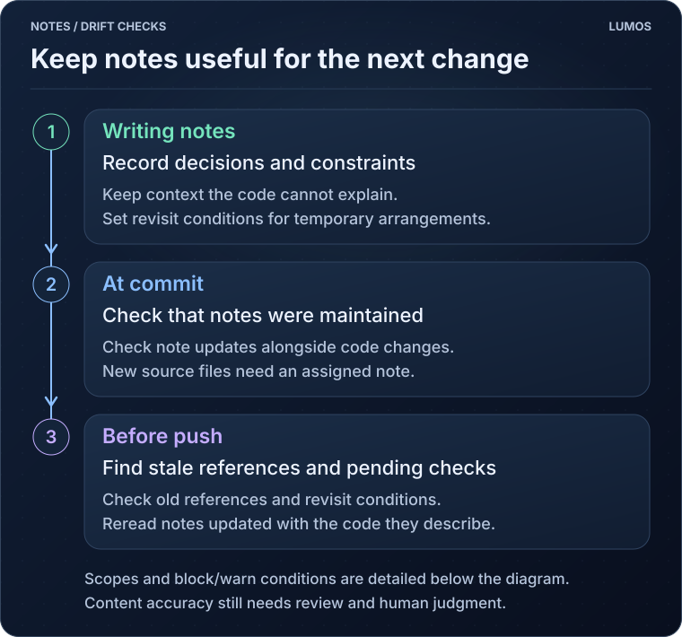

<p align="center">
  <picture>
    <source media="(prefers-color-scheme: dark)" srcset="assets/lumos-logo-dark.png">
    
  </picture>
</p>

# Lumos

[繁體中文](README.md) · **English**

[](https://github.com/EnzoHsieh-Android/Lumos/actions/workflows/ci.yml)

**Keep the reasons and verification results alongside the code AI changes.**

Lumos is a toolkit installed in a Git project, used with Claude Code or Codex. You discuss requirements with AI as usual. Lumos adds working instructions, commands for finding project notes, and checks that run when code is committed or pushed.

It addresses a familiar handoff problem: the code is still there, but the discussion that explains it is hard to find.

For example, an API returns both an old field and its replacement. Someone taking over might remove the old field, without knowing that a customer's devices still need it. The code may not explain which customer uses it or what needs to happen before removal. If that reason stays in one chat, the next person or AI has to investigate again.

Lumos requires AI to keep these reasons in Markdown notes, versioned with review reports and test records. They can then be consulted when the related code changes. This suits projects that need ongoing maintenance or frequent handoffs. Keeping records, running checks, and reviewing changes takes time; additional AI reviewers also use more model capacity.

[See a typical change](#use) · [Install and try it](#start) · [Explore the checks](#mechanisms)

<a id="use"></a>

## What it looks like

Here is an illustrative workflow using the API example above. You might ask AI:

> The new client uses the replacement field. Please tidy up this API. First find out why the old field is still there, and ask me if it is unclear whether we can remove it.

AI reads the code and looks up the related notes. If a note says some devices have not been upgraded, it has a reason to check with you instead of removing what looks like duplication. Once you decide, AI changes the code, runs relevant tests, arranges review according to risk, and updates the project records.

At the end, you can inspect the code changes, decision notes, review reports, and test records. In this example, the next person should be able to find who needs the old field, when it can be removed, and which old- and new-client scenarios were tested.

**AI performs this work by following the instructions. Lumos commands and Git checks help find notes and validate records, and can block a commit or push.** A note does not prove its reasoning is correct, and a test record does not prove the feature works. The contents still need review.

<details>
<summary>See real output: AI changed code but forgot to update notes</summary>

Take the commit check as an example. If AI changes the refund logic and commits without writing notes, it receives this message (real output, excerpted and translated from Chinese):

```text
$ git commit -m "feat: check whether an order was already refunded"

Blocked: this commit changes code, but not a single knowledge note was touched.
…
Code changed in this commit (1):
   • src/payment.py
…
Pick one of two paths:
   1. Update the notes that should change, add them to the commit, and commit again.
   2. This really needs no note change (typo, formatting, comments, work in progress) → skip this check:
        git commit --no-verify -m '<message>'
      Skipping is recorded; it is not a silent pass.
```

The message is for AI: its instructions require it to update the notes and retry. If no update is needed, such as for a typo fix, it can skip the check, but the skip is recorded. You mainly decide business trade-offs and whether to accept a risk.

</details>

## How it works

<p align="center">
  <a href="assets/map-en.svg">
    
  </a>
</p>

1. **Read the code, add context**: AI reads the code first. When it edits a file, the tool supplies related notes with reasons the code cannot reveal. For descriptions of code behavior, code takes precedence over conflicting notes. For deployment state, business constraints, and other questions code cannot answer, verify or ask a person.
2. **Assign AI reviewers based on risk**: See "How code review works" below.
3. **Every finding needs an outcome**: Fix it, explain why it will not be fixed, or disprove it with evidence. Addressing every finding is a condition for passing this gate.
4. **Update the notes**: Record trade-offs and verification methods in the note responsible for that file, ready for the next change.

The outer loop checks the process itself; see "How the toolkit keeps improving (evals)" below.

## Where humans come in

By default, Lumos leaves line-by-line diff review to AI and automated checks. People handle these decisions:

- Requirements, trade-offs, risk acceptance, and irreversible operations.
- A review that hits 3 rounds without passing: a standard- or high-tier review (design or code review alike) stops for a human to decide whether to add a round or accept the risk; AI cannot declare a pass itself.
- Whether rules still fit the business requires human sign-off and a record; tests cannot establish this.

Each round's review reports and outcomes stay in the repo for spot-checking at any time.

<details>
<summary>Details: recording the human decision and retrospective</summary>

- Record the human decision with `lumos loop cap-decision`.
- Before continuing, record a valid retrospective with `lumos loop retro`, or a reasoned skip; once the human decision is recorded, without one of these no further review records can be added and the check that every finding was handled cannot pass.

</details>

<a id="start"></a>

## Install and limits

You need Git, Python 3.14+, and Claude Code or Codex. The following command downloads and runs the installer. Run it in the project directory:

```bash
curl -fsSL https://raw.githubusercontent.com/EnzoHsieh-Android/Lumos/release/get.sh | bash
```

**Version scope: this README describes `main`; the installer above defaults to `release`.** The branches may differ. Check the installed source and version rather than assuming it includes every main update. The [October 1–7](docs/updates/2026-10-07-readme-audit.md) and [October 7–10](docs/updates/2026-10-10-readme-audit.md) update audits (Chinese) list each audit's commits, documentation changes, and how main and release differed at the time of each audit.

When asked to initialize the current directory, check that it is correct before entering `y`. After installation, start a new AI session and run `lumos enforcement` to inspect which checks are connected. Codex’s trust approval cannot be read locally; follow the prompts and trigger a hook once to confirm it runs. For Windows, offline installation, and removal, see the [onboarding guide](ONBOARDING.md) (Chinese). To upgrade an existing project, run `lumos update --dry-run` first to preview which rule files and tool files would change; it changes nothing.

<details>
<summary>Projects already on an older Lumos: moving to Python 3.14</summary>

- After updating, commits and pushes are blocked on machines without 3.14, with install instructions (macOS: `brew install python@3.14` or `uv python install 3.14`). If `python3` points to an older version, lumos finds 3.14 and re-runs itself.
- Set your CI's `actions/setup-python` to 3.14.
- Once 3.14 is installed, run `lumos install` once so the Claude/Codex hooks use it too.
- This changes the Codex hook command lines, so Codex may ask you to re-approve them in an interactive session. Codex's trust state cannot be read locally; run `lumos enforcement`, then trigger a hook once to confirm it actually runs.

</details>

Lumos guarantees neither quality nor security and does not replace engineering judgment: notes can go stale, AI reviews can miss problems, and records do not prove correctness. People still decide business trade-offs, irreversible operations, and risk acceptance.

For a first try, choose a small change with a clear expected result. In a new AI session, ask:

> Read this project's working instructions, then help me change [specific requirement]. When finished, tell me what changed, which checks ran, and where to find the notes and review records.

Look through one complete result before deciding whether to use the workflow for more features.


<details>
<summary>Tool components and Claude Code plugins</summary>

It brings the ideas behind ADRs (architecture decision records), CODEOWNERS, and pre-commit into AI development: record decisions, assign file ownership, and check changes before committing. The aim is to help people assess changes through their decisions, reviews, and verification records, and focus their attention on requirements and risk.

The core toolset consists of a single-file Python CLI using only the standard library, Git hooks, AI working instructions in CLAUDE.md / AGENTS.md, and project notes.

<details>
<summary>Three plugins for Claude Code only</summary>

- One records session events; inspect them with `lumos events`.
- One requires the state needed for a handoff to be kept when the conversation is compacted.
- One restricts which tools agents marked as reviewers can use and where they can write files directly. This is not a security sandbox: their Bash remains a full shell.

These plugins have no Codex counterpart.

</details>

</details>

<a id="mechanisms"></a>

## Explore the checks

Each section below starts with its purpose. Expand it for diagrams, conditions, and commands when you need them; you do not need to read every detail on your first visit.

## Connecting plans, features, and verification

Notes live in `docs/<project>-knowledge/` and can be read in a text editor. Plans, feature descriptions, verification results, and incidents have separate notes with links between them. The “graph” means these linked notes; a “node” means one note.

For the API example, the note should explain who needs the old field and what must be checked before removing it. Read the code to see how the fields are returned today. The diagram below illustrates relationships between notes; it is not a separate graphical interface you need to operate.

<details>
<summary>See how notes connect and how important rules are checked</summary>

Linked notes form a “graph”; each note is a “node” covering a plan, feature description, verification record, or incident. The fictional shop below shows how they connect:

- **From plan to verification**: Plan checkout and payment integration, build the features, then record results from checkout end-to-end tests and duplicate-payment stress tests.
- **When an incident happens**: If canceling an order fails to refund points, the incident links back to checkout, followed by a repair plan, a fix, and a regression test.
- **How important rules are guarded**: Record the rule as a line marked ★INVARIANT★ (a “contract line”), bind the tests that check it, and have an AI that took no part in the work audit it independently. You can also use `lumos guard` to break the code on purpose in an isolated copy and confirm the tests actually fail.

The gold rings are only an illustration of a note that carries rules that must hold and links to verification records; the tool has no “protected” status.

<p align="center">
  <a href="assets/graph-demo-en.svg">
    
  </a>
</p>

</details>

## How code review works

Reviewers are separate AI agents that read the change and its context from different angles. Ordinary changes get one or two reviewers; high-risk changes get at least seven per round, taking more time and model capacity.

Every finding needs an outcome: a fix, a reason for leaving it, or evidence that disproves it. A “gate” is a check that decides whether work can proceed. Some checks block operations automatically; others are instructions AI is expected to follow. Their scopes are explained separately below.

<details>
<summary>See risk tiers, the review diagram, and repair verification</summary>

<p align="center">
  <a href="assets/risk-review-en.svg">
    
  </a>
</p>

- **Assess risk first**: Before a push, fixed rules scan newly added code for patterns prone to problems.
- **Choose how many AI reviewers to assign**: Ordinary changes get 1 to 2; high-risk changes get at least 7 per round: 5 look for problems, 1 checks architectural consistency, and 1 checks security. A finalized design spec adds 1 reviewer to check against it.
- **High-risk changes need a review outcome to push**: Record a pass or a skip with a written reason before pushing; otherwise, the Git hook blocks the push.

**Fixing a defect must also preserve behavior that already worked.** In the round after a fix, the instructions require:

- **Pinning the before and after versions**: A test that reproduces the original problem must fail before the fix and pass after it; behavior that already worked must pass on both versions.
- **Fresh AI reviewers**: New reviewers with no context from earlier rounds look for side effects of the fix.
- **Care when a fix is mixed with refactoring**: Intermediate verification points are kept; some high-risk cases are also spot-checked to confirm the tests catch regressions.

`lumos loop fix-check` checks fix records and post-fix tests, but it only warns and does not replace these checks or the next review round. References, snapshots, and records in the review material are also checked, so incomplete evidence is not accepted as a pass. See the [code review instructions](skills/lumos-code-loop/SKILL.md).

</details>

### How security is reviewed

A security guardrail is a registered protection against a specific risk, such as “only the order owner can view the order.” The project runs tests or scanning tools, and Lumos checks whether the results meet the requirements and match the current version. **Without registration, this gate does not check security.**

These checks help catch omitted work and mismatched evidence. They do not prove the product is secure or prevent deliberate falsification. Approvals that require a person remain that person's responsibility.

<details>
<summary>See the security diagram, registration, and approval limits</summary>

Business rules (★INVARIANT★) record agreements that must hold. Security controls are registered and verified separately, making gaps in their evidence easier to find. Filling in a form is not enough: evidence must meet the requirements for that kind of control and match the current version.

<p align="center">
  <a href="assets/security-lane-en.svg">
    
  </a>
</p>

- **Nothing is checked until it is registered**: Security guardrails are registered in feature notes (see the [security guardrail guide](skills/lumos-project-notes/commands/10-資安護欄.md), Chinese); the working rules tell AI to register them for features touching login, permissions, payments, or personal data. **In a project with no registration, the push gate does not check security at all.**
- **Asking the right security questions**: When AI writes a plan following the working rules, the questions for the requirements, architecture, verification, and delivery stages include security questions drawn from a 14-category threat table; they do not pop up on their own, AI has to ask for them as the rules say.
- **Inventory of guardrails**: `lumos security list` shows which security guardrails a project has registered and which entry points have none. It only takes inventory and runs no tests; a complete inventory does not mean the product is secure.
- **Evidence must come from tools that actually ran**: The gate reads the output of test, load, and scanning tools and judges it itself; changing the code without re-collecting evidence makes it stale.
- **Local and CI evidence checks**: The local pre-push hook blocks a push when evidence fails, is stale, or is missing. CI checks after the push and reports failure if the evidence does not pass.
- **Exceptions require user approval**: To let something through temporarily, the user signs an approval with their own SSH key; it expires after at most 30 days.
- **Items that need human judgment must have a review record**: An AI review must say the reviewer is AI, and it cannot stand in for an approval a person is responsible for. A human review counts only when the user signs it with their own SSH key.
- **The project installs and runs the tools; lumos only reads the output**: AI does not install them on its own; the user approves each tool before a project uses it.

<details>
<summary>Details: threat table, evidence kinds, approval records, tool approval</summary>

- **Threat table coverage**: object authorization, authentication, injection, flow abuse, data exposure, outbound requests, secrets, supply chain, audit logging, and more, mapped to STRIDE, OWASP ASVS 5.0.0, WSTG, and the API Top 10. Claude and Codex review each table version independently; a new version is approved only when both agree.
- **What else the inventory shows**: `lumos security list` also shows how far each guardrail's evidence has been checked; `--questions` turns uncovered cells into candidate questions. Its result is always `not_assessed`.
- **Evidence kinds**: Each guardrail needs minimum evidence kinds for its category: JUnit tests, fault injection (guard kill), k6 load and concurrency summaries, and SARIF scan results (for example Semgrep, gitleaks, OSV-Scanner, ZAP). Scans also need a coverage proof showing they actually scanned something. Reports are bound to versions and hashes. `lumos security evidence` runs the same judgment as the push gate.
- **Where the push gate runs**: In every project connected to lumos, `code-loop check` in pre-push and CI applies it, tag pushes included.
- **Approval records**: They go into the append-only `.lumos/security-approvals.jsonl`.
- **Tool approval**: The tools live in the project that uses Lumos, which runs them and commits their output; lumos itself stays dependency-free. Before a project uses a tool such as k6, gitleaks, OSV-Scanner, Semgrep, or ZAP, the user approves each one: install source, pinned version, time budget, and allowed targets.

</details>

The limits of this layer, stated plainly:

- **It guards against slips, not deliberate forgery**: Under the trust principle, an AI operating normally is assumed honest. The gate catches forgotten evidence refreshes, evidence attached to the wrong thing, and leftover settings; it cannot stop an AI that deliberately generates its own key and signs, or writes the approval file by hand.
- **`--no-verify` skips the local gate**: CI goes red only after the push and cannot take back a commit already on the main branch.
- **Qualified evidence is not a secure product**: Consistent tool evidence shows the results match the version; it does not show the criteria were right or the report is trustworthy.

Review is one layer. Risk classification, AI review, approval rules, external rules (linters), and tests each have gaps. Stacking them makes it harder for a problem to pass through them all: the Swiss cheese model.

<p align="center">
  <a href="assets/swiss-cheese-en.svg">
    
  </a>
</p>

</details>

## Tests must be useful, not a rewrite of the code

Green tests can mean the code and the tests made the same mistake. Lumos instructions require expected results to come from the requirements, followed by checks that breaking the relevant code actually makes the tests fail. This is a development and review requirement; a tool cannot decide whether the expected answer is correct.

<details>
<summary>See a test example and the supporting tools</summary>

**All tests passing does not mean the feature is correct.** If a test computes its expected value with the same algorithm as the production code, both can make the same mistake and still pass. If it only checks that the source contains a certain function name, the actual behavior can break while the test stays green.

Say the requirement is "3 items at 5 each should total 15":

```python
# Bad: rewrites the implementation's algorithm, so it cannot independently judge whether the algorithm meets the requirement
expected = quantity * unit_price
assert total_price(quantity, unit_price) == expected

# Good: checks the actual result against a confirmed requirement case
assert total_price(quantity=3, unit_price=5) == 15
```

This case is only a starting point; discounts, empty orders, invalid input, and other behavior still need to be covered according to the requirements. Lumos asks developers to state up front the input, the expected result, where that expected result comes from, and the error the test should catch. For bug fixes and key guards, they must also confirm that the fault actually turns the target assertion red, then restore the code and see it go green. Structure and wiring checks can stay, but they cannot replace behavior verification.

**Catching a broken program does not mean the expected answer is right.** The program and the test can copy the same wrong requirement, so first check the expected answer against an independent source. Then confirm that breaking the relevant code makes the test fail and restoring it makes the test pass. If a behavior test seems tied to one particular implementation, also check that it still passes after a refactor that keeps the behavior. Language-specific workflows, tool verification cases, and evidence limits are in the [test quality onboarding standard](skills/lumos-project-notes/commands/test-quality-standard.md) (Chinese).

The full practice is in [Implementation test quality](skills/lumos-project-notes/commands/03-寫回圖譜.md#實作測試品質) (Chinese), shared by the development and review instructions. These are development and review requirements; automated checks verify record formats but cannot judge for a person whether a test is actually useful.

<details>
<summary>Helper tool: <code>lumos test-quality</code></summary>

- **`scan`**: Once Lumos is installed, `lumos test-quality scan <test file or directory> --json` lists suspicious test patterns, read-only, for a person to look at. For Python it finds four kinds; for other languages (PHP included), an optional local Semgrep finds assertions that compare a value with itself.
- **`capture`**: Runs a trusted local test runner only when you ask it to, and saves JUnit output and source snapshots.
- **`check`**: Verifies evidence for the normal → broken → restored sequence, optionally with before-and-after refactor evidence.
- **Limits**: **Finding no suspicious patterns, passing every test, or detecting an injected fault cannot alone prove the expected answer is correct.** The tool provides no sandbox and does not replace reviewing the requirement source; check the scope with `capabilities` first, then read [operation and capability limits](skills/lumos-project-notes/commands/03-寫回圖譜.md#事後掃描與執行收證已安裝-cli) (Chinese).

</details>

</details>

## Android: checking speed and memory on a real device

After an Android change, Lumos checks two things on a real phone or tablet: **did it get slower**, and **does it hold on to memory it never gives back**. When something is wrong, it digs down one layer at a time until it can name the function and line responsible; every step is written into an evidence record, so someone with the same raw data can rerun it and get the same result.

The step "read the performance recording and find where it gets stuck" follows Google's public [android-profiler skill](https://github.com/android/skills) (analysis instructions written for AI agents) as is, instead of inventing a separate method. Lumos handles the joining-up around the official skill: deciding whether it really got slower and whether to dig deeper, connecting the tools of each layer, telling which kind of screen code is to blame, catching memory a third-party library forgot to free, and writing the process down as a rerunnable record.

<p align="center">
  <a href="assets/android-e2e-en.svg">
    
  </a>
</p>

<details>
<summary>See what each layer does, lab results, and limits</summary>

**Layered like a doctor's visit: take the temperature first, draw blood only if there is a fever, order a scan only if the blood test is off.** Not every tool is switched on at once: some tools change how the app runs, and memory snapshots may capture user data; recording everything when nothing is wrong means paying the highest price every time.

| Layer | Question | How | When to go deeper |
|---|---|---|---|
| L0 | Did it get slower? Does it meet the agreed standard? | Run Google's performance test tool, Macrobenchmark, then `lumos macrobench` compares it with the saved baseline and the human-set standards | Slower than the baseline, or below standard |
| L1 | Where is it stuck? Busy computing, or waiting on something? | Each test run leaves a millisecond-by-millisecond recording (a Perfetto trace), read with the steps of Google's official skill; it also works out whether the time went to the newer (Compose) or older (XML) way of building screens | The app itself is busy → deeper; it is waiting on another program or a file → stay here and follow who made it wait |
| L2 | Which function, which line? | simpleperf (Android's performance sampling tool) notes "which code is running right now" every millisecond; the line that shows up most is the culprit; phone settings are restored afterwards | That line creates lots of objects → deeper |
| L3 | What is using memory, and why is it never freed? | Perfetto's `heap_profile` shows what allocates heavily, and `java_heap_dump` takes memory snapshots to find which variable keeps holding on to it | — |

**Tools per layer at a glance.** L0 is Google's performance test library Macrobenchmark plus `lumos macrobench` for the verdict; L1 is a recording from Google's system tracing tool Perfetto, read with its query tool `trace_processor` following the official skill; L2 is simpleperf from the Android NDK; L3 is Perfetto's `heap_profile` and `java_heap_dump`.

**Why Google's official skill.** Google maintains the steps for reading performance recordings and updates them with its tools, which is more reliable than writing our own. The skill and every tool are each pinned to a fixed version and re-verified on upgrade, so a result found today still matches when the same record is rerun later.

**Memory: catching "the library offers a release method, the app forgets to call it".** Libraries such as players or maps need release to be called when a screen closes; forgetting keeps the memory in use. The project's own UI test (the driver command is set in the project's settings; Android's UI Automator is what has been verified, and Maestro is planned next) opens and closes the same screen on the phone again and again, Lumos's collection script gathers data alongside, and `lumos macrobench` then judges seven things (each one is judged only if the project's standards file has a line for it):

- On the C/C++ side, memory nothing uses any more that was never freed (Android's built-in `dumpsys meminfo --unreachable`, scanned once after the warm-up and once after the measured rounds).
- Objects that keep multiplying each time the screen opens (Perfetto's `java_heap_dump` takes a snapshot after the warm-up and after the measured rounds, and `trace_processor` counts each kind of object; snapshots are taken only after test data only is declared).
- How many of a named object remain after the screen closes (from the second snapshot above).
- The highest memory use (Perfetto records the whole open-close run, and `trace_processor` finds the maximum).
- Whether the app crashed or was killed by the system (Android's built-in `dumpsys activity exit-info` before and after, plus a check that the process did not change).
- Whether Android's built-in StrictMode check caught an unclosed resource, an unregistered listener, or a screen kept alive (`adb logcat` collects this app's log during the run and keeps only the violation lines). This needs both: the project turns StrictMode on in its test build and declares so in its settings; without the declaration it is skipped. Declared but not actually turned on, it receives no violations and is wrongly judged a pass.
- Whether the screen froze for more than 0.7 seconds (frame times from the same Perfetto recording).

**It can also list "who still holds the most C/C++ memory when the measurement ends"; this only lists, it does not judge.** The scan in the first item only finds memory that no pointer refers to any more; when a library keeps objects in its own internal list and never lets go, the scan reports 0. Once this is turned on for a memory scenario in the config file, the collection script, after all the usual measurements are collected, restarts the app and runs one more warm-up and open-close round, recording this round only with Perfetto's native allocation sampler (heapprofd). C/C++ memory still held at the end and allocated after recording started is listed when one call site adds up to 1 MiB or more, sorted by size, at most 20 printed. Each entry shows the allocating function, which library file (`.so`) it is in, which app method called it, and how much is still held. Memory still held may also be a cache or an object pool, so it is a lead only and not part of the seven checks above.

When one of the first four (the memory ones) fails, it jumps straight to L3: the two middle layers look at where CPU time goes, and memory problems do not show there; the project must first declare test data only, otherwise it stops at L0 and records the gap. A frozen screen goes through L1 as usual; crashes and StrictMode violations are read straight from the collected exit records and log.

**Every step goes into the evidence record.** Phone model and state, the installed app (matched by file fingerprint), each query with its expected result, and why the next layer was needed all sit in one folder, with a `rerun.sh` that reruns every query with an expected result on the same raw data and compares the results in one go; the raw data stays on the local machine and is not committed. Before committing, a separate AI that knows nothing of the background re-judges every conclusion from this record alone; if it cannot, the record is not clear enough.

**Lab results** (one Samsung tablet (model SM-X710) and a small app with deliberately planted problems):

- Each list row deliberately waits 8 ms longer: L0 reports the screen got slower (each redraw of the screen is a frame; for the slower tenth of frames, processor time per frame went from 4.3 ms to 10.4 ms), and L2 points straight to line 36 of the lab app's `MainActivity.kt`.
- A third-party library written in Java, not released when the screen closes: 5 objects left behind; L3 shows the library's own internal list holds them.
- A third-party library written in C/C++, not released: 10 MB extra (5 open-close rounds, 2 MB each), traced to the library file and the app function that created it.
- Listing the call sites that still hold the most C/C++ memory: in three scenarios (not released, held by the library's internal list, object pool) each listed that call site, holding 10, 10 and 4 MiB (for the first two, the caller was also confirmed to be the app's Kotlin method); a scenario that holds nothing lists none. In the held-by-a-list case the "nothing uses it" scan reports 0, and only this list shows it.
- Slowdowns from three kinds of screen code were each put in the right category and traced to a function; a separate AI that did not know what was planted found the problem in all three from the measurements alone.

**Current limits.**

- Verified on one tablet and one lab app only; the numbers do not represent a production app, and tools may behave differently on other brands.
- It reminds, it does not block pushes: millisecond numbers drift with the phone and its temperature, so they are not suited to a hard gate.
- Memory snapshots are off by default: a project must first write down who agreed, and on which day, to run on test data only; snapshots stay on the local machine, each later run of the collection script deletes those older than 7 days, nothing is deleted if it is not run again, and you delete them yourself when done.
- Listing who still holds the most C/C++ memory needs Android 11 or later; if the version is too old, or this step does not have enough time left to finish, it is skipped with the reason written down, and the other checks are unaffected. Once turned on, each scenario runs one extra open-close round, so collection takes longer.
- The allowed margin for "counts as slower" is provisional (10% by default, with a 1 ms floor) and will be reset from repeated real-device runs.
- Speed and memory are now part of the "Device acceptance" section below; running `lumos macrobench` on its own still only warns.

**To start:** after running Macrobenchmark in an Android project, run `lumos macrobench` (add `--update-baseline` the first time to save a baseline); when it reports a problem, ask the AI to follow the `lumos-android-evidence` skill layer by layer. Configuration and standards are described in [Macrobenchmark acceptance limits](docs/lumos-toolchain-knowledge/Projects/Macrobenchmark驗收門檻_計劃.md) and [memory and stability checks](docs/lumos-toolchain-knowledge/Projects/Android記憶體與穩定性驗收_計劃.md) (Chinese).

</details>

### Device acceptance: by feature while developing, a record for this version before pushing (end-to-end acceptance)

**One script: while developing, run only the feature you are working on, or just one of its use cases; before pushing, check the whole app and keep the result as a verification record; pushing is blocked for a version without a passing record, and running each feature your changes touch by feature also counts.** Each use case can have four things: tap through Maestro (a tool that drives the screen from a text script of what to tap and type) flow files, compare screenshots against baselines a person approved, run speed tests, and open and close a screen repeatedly to check memory and stability. Every run builds and installs the app first; `lumos android-e2e judge` then decides pass or fail. When a UI flow fails, the terminal prints, after that flow, what Maestro left behind (the step log and failure screenshots) and any app crash from that attempt; flows that often needed a retry to pass are named after the check.

```
sh scripts/templates/android-e2e-run.sh --changed                  # while developing: run the use cases of the features your changes touch
sh scripts/templates/android-e2e-run.sh --feature player           # every use case of this feature
sh scripts/templates/android-e2e-run.sh --case player.open-close   # just this use case (add --no-perf or --no-memory to skip those parts)
sh scripts/templates/android-e2e-run.sh                            # the whole app, writes the verification record
lumos android-e2e history                                          # the last 20 checks (filter with --feature, --case; --last for more)
lumos android-e2e history --flaky                                  # which UI flows have often needed a retry to pass
lumos android-e2e check                                            # before pushing, see whether the push check would block and why
```

<p align="center">
  <a href="assets/android-acceptance-en.svg">
    
  </a>
</p>

<details>
<summary>How to set it up, how to read the result, experiment results and limits</summary>

**Setup.** Add an `e2e` section to the project's `.lumos/macrobench.json`: which folders count as app code, how to build, where the APK is, which flow files to run; screenshots, memory and stability, and speed each run only when switched on. For screenshots, install [maestro-visual-toolkit](https://github.com/EnzoHsieh-Android/maestro-visual-toolkit) into the project and record baselines first. `lumos update` copies the script into the project's `scripts/templates/`. Details in [Android end-to-end acceptance](docs/lumos-toolchain-knowledge/Projects/Android端到端驗收_計劃.md) (Chinese).

**Feature map.** Add `features` to the `e2e` section: each feature lists the code paths it owns (`--changed` uses them to find features from changed files) and its use cases; each use case lists its flow files, screenshot screens, speed test methods and memory scenarios. Write `{{TEST}}` in the speed command and it is replaced with the chosen test method; memory scenarios live in the top-level `stability_scenarios`, one screen-cycling driver each. A map that names a flow or scenario that does not exist is rejected when the configuration is checked. Code that everyone shares (networking, shared components, `Application`) goes into `shared_paths` in the `e2e` section: changing it before a push requires a whole-app run (the paths must sit under `app_dirs`; add an outside module to `app_dirs` first). To see whether the map is complete, run `lumos android-e2e coverage`: it lists app code files that belong to no feature (grouped by folder; `--files` lists each file, `--changed` looks only at what you changed), features whose use cases list only speed tests, and flow files and screenshot screens no use case uses, plus how many shared files sit under `shared_paths`; it reads the configuration in your working directory, so you can rerun it right after editing the map without committing first; it only reports and blocks nothing.

**Two ways to split a run.** While developing you can run only part of it, sliced two ways that stack:

| Slice | How | What runs |
|---|---|---|
| By feature | `--changed` (from changed files), `--feature <feature>`, `--case <feature.case>`; join several with commas | Only the chosen use cases' flows, screenshots, speed methods and memory scenarios |
| By check | Add `--no-perf`, `--no-memory` (only together with a choice above; a whole-app run always runs everything) | Skips speed or memory and stability; those use cases are recorded as incomplete |

For example `--case list.scroll --no-perf --no-memory` runs only that use case's UI flow and screenshots, with a result in under a minute. A use case that lists only speed, or whose checks were all skipped, has nothing that passes or fails, so it is recorded as not judged and returns 1 rather than counting as passed.

**The push check blocks.** Before a push, the check reads this version's verification record from the commit being pushed (so commit the record first): a whole-app run that passed lets it through; without one, it looks at which feature each changed file belongs to, and if every use case of those features was run by feature and passed, it also lets it through and prints an extra "passed by feature" line. Changing `shared_paths`, a file that matches no feature, or the acceptance configuration itself requires a whole-app run. When it blocks, the terminal prints the command to run; if it is a false block and the message prints a waive line, use it (some blocks print none, such as an invalid config, a missing mainline or fork point, a timeout, an unreadable or oversized record, or a version without or with a removed e2e section; follow what they say instead), `lumos android-e2e waive <fingerprint> --commit <commit> --note "<reason>"`: answering y in a terminal counts as a person's waiver, with no interactive terminal it counts as the AI's, and the push, `lumos doctor` and the session-start notice (in projects with a knowledge graph) keep listing it until a person marks it seen with `lumos android-e2e waive --ack --all`. To skip the whole check just this once: `LUMOS_SKIP_ANDROID_E2E=1 git push` (recorded). A project that does not use end-to-end acceptance sees not a single line from this check.

**Separating use cases in the notes and binding the tests.** The feature map says what runs; the graph note says why the use case must hold and what breaks if it changes. The two are matched by the same use-case name:

- One Systems note per feature (the home of that feature's code); each use case gets a contract line in its summary, for example `KEY:★INVARIANT★ the list shows its first row on open [test:ui:list_first_row]`. If you are not sure it is a contract, do not mark it; write a sentence in the body pointing at the flow file instead.
- In `[test:ui:<name>]`, `ui` is a platform name: add `"ui": {"profile": "maestro", "root": "."}` to `platforms` in `.lumos/config.json` (with more than one platform, also set `default_platform`). `<name>` matches the `name:` field in the flow's yaml and must start with an English letter or underscore (for example `name: list_first_row`); a name starting with Chinese is not recognised.
- The same flow file is also listed in that use case's `flows` in the feature map. The two sides line up by the same flow file; `lumos android-e2e coverage` lists the two ways they can drift apart: use cases whose flow files no note binds or mentions in its body, and flows a note's contract binds that no use case in the feature map lists (projects without a knowledge graph skip both). It only reports and never blocks; change both sides together and run it again to check.

**Two kinds of record.** Every run (whole app or by feature, passed or failed, interrupted, or stopped by the judge without a record) adds a line to the local check log `.lumos/artifacts/android/history.jsonl`: when, which version, whether there were uncommitted changes, which use cases were chosen, each item's result, and where the evidence is. When the working tree was clean from start to judgement and the version did not change, the results also go into the verification record for this version: a whole-app run fills `runs`, a by-feature run records its use cases in `feature_runs` (one entry per use case; it is marked incomplete when speed or memory it has was skipped, or when it lists only speed and nothing that passes or fails; a failure always replaces the earlier result; only a run that was not fully judged, or an incomplete pass, keeps the complete result already there). The record is tied to "this version of the app code and test materials": change the app code, a flow file, a baseline image or a threshold, and it no longer counts.

**Why commit first.** The verification record is tied to a commit, so a whole-app run refuses to start with uncommitted changes. A by-feature run still runs, but if there were uncommitted changes when it started it only writes the local log (the app it built is not this version, even if the changes are put away mid-run). Nothing is recorded if the version changes mid-run. The order is: change code → commit → run the check → commit the record separately.

**Reading the result.**

- **Passed**: for a whole-app run the record is written; commit it and push. For a by-feature run, the last line says whether the result went into the record (with uncommitted changes at the start it only goes into the local log). A slowdown only adds a warning and still passes.
- **Failed**: if any part failed, the result is failed, and the terminal shows which part. A failed UI flow comes with its report path and a failed screenshot with its match rate and diff image, so read those; when memory fails, the raw numbers are in this run's artifacts: the `stability` section itself in `.lumos/artifacts/android/<run-id>/stability.json`, other memory scenarios next to it in `<run-id>.<scenario>/stability.json`; the layered check above takes it from there. Each scenario keeps its own recording and nothing is cleaned up automatically, so delete old ones yourself.
- **Not judged**: nothing failed, but a part could not run, for example a failed build or install, or the run was interrupted (an interruption still writes this record). That is a setup problem: fix it and run again.
- **No record**: the preflight stopped (bad configuration, uncommitted changes on a whole-app run, the memory part is chosen but a Perfetto tool is missing, or `--changed` matched no feature), or the version changed mid-run. Fix it and run again.

A failed UI flow is retried once; it only counts as failed if both runs fail. Speed still only warns, for the same reason as above: millisecond numbers drift.

**If a screenshot fails because you meant to change the screen, replace the baseline; do not lower the threshold.** Replacing a baseline redefines "this screen is correct", so a person looks at the new image before it is recorded (the toolkit's `visual-record.sh`), then the check is run again.

**Experiment results** (same SM-X710 tablet, same lab app):

- With all four parts on, the full run passed in about 3 minutes (build cached, speed at 5 rounds; the recommended 20 rounds adds a few minutes).
- Split runs (same tablet): the list use case's UI and screenshot alone took about 33 seconds, the player's memory scenario alone about 43 seconds, the list use case with speed about 2 minutes; `--changed` after editing the list code picked only the list use case; the runs that skipped speed or memory were recorded as incomplete and did not replace the earlier complete result for the same version; the player use case has only memory, so `--no-memory` recorded it as not judged and returned 1. The list's speed test occasionally fails on its own (it reaches the bottom on the second swipe); that only warns, does not affect passing, and passed on a rerun.
- Making the app skip releasing a C/C++ library when the screen closes: judged failed, with only the "C/C++ memory nobody points to" item red and everything else passing.
- Scenario test: asking the AI in plain words to "make the list text bigger, check it, then commit", without mentioning end-to-end acceptance. Before the manual was updated, the AI had to read the tool's source code to find this check; afterwards the same task found it straight from the manual and ran all four parts in the order commit → check → commit record, and passed.

**Current limits.**

- It only blocks local pushes: CI does not run this check, and skipping the push hooks (`git push --no-verify`) gets past it.
- When a push passes by feature, code that other features also use but that is not listed in `shared_paths` can break those other features without the push check noticing.
- Screenshot comparison catches layout shifts but not a change of a few characters; write key text into the flow file as "this text must be visible".
- `--changed` only knows the code paths and the use cases' flow files listed in the feature map; changed files in the app folders, under `.maestro/` (flows, shared flows, screenshot material) or in the acceptance config and thresholds that match no feature are listed (ordinary docs are not), and the push check asks for a whole-app run when it sees such files. It compares against where the branch left the main line; when you work directly on main, it compares against that branch's remote counterpart, so commits you have not pushed are still seen.
- Verified only on one tablet and one lab app.

</details>

## How notes are kept from going stale (drift)

Notes need maintenance after they are written. Lumos checks whether notes were updated with code, looks for stale names, links, and pending items before a push, and asks AI to reread notes when their meaning needs checking. “Drift” means the code and notes gradually stop agreeing.

<details>
<summary>See the three checks and their configuration</summary>

Notes that still describe old code mislead AI. When I planted incorrect notes in a synthetic project, the smaller model, Haiku 4.5, dropped from 20 correct answers out of 25 to 12. So Lumos puts one checkpoint at each of three moments: writing notes, committing, and pushing.

**First check: when writing notes, record only what the code cannot show.**

- Fields, defaults, and flows the code already shows are not copied into notes; duplicating them adds maintenance work and risks drifting from the code.
- At commit time the tool blocks two patterns automatically: new code line references, and current-state descriptions (such as deployment settings) without a source. The rest relies on working rules and review.
- Sentences like “there is no refund page yet” go stale the fastest: once the page exists the sentence is wrong, and nobody comes back to fix it. The tool suggests rewriting it as a one-line “revisit condition,” such as “check again when the refund page's file appears.” Once that condition is written, the push in which the file appears is blocked until the sentence is updated or kept with a written reason.

**Second check: when committing, code changes need note changes.**

- A commit is blocked if it changes code without touching any note, or adds a source file with no note assigned to it.
- The “code changed, notes untouched” check always blocks and projects cannot turn it off. If no note change is really needed (a typo fix, say), skip it with `git commit --no-verify`; a post-commit hook records every skip.

**Third check: before pushing, find notes that still describe the old code.** Any of these blocks the push:

- A name in the code was deleted or renamed, or a code file was deleted or moved, and a related note still mentions the old name or path (scope in the details below).
- A rule's test is live, but its note still says “test to be added.”
- A linked note was deleted, or a link between notes is broken.
- A revisit condition has been met, or a rule's own “retire when…” condition has come true.
- The code and the note that manages it both changed in this push, but AI has not reread the whole note against this change and recorded the reread. Notes often just get a new paragraph while older sentences go unread: the code moves from three variables to four, yet the note still says three. Name matching can miss these differences in meaning, so a separate reread checks the whole note. This blocks local pushes only; CI just warns.

<p align="center"><a href="assets/drift-guard-en.svg"></a></p>

<details>
<summary>Details: what is checked, what can be relaxed, and cleanup when notes close</summary>

- **Scope of the old-name check**: Python functions, classes, module- or class-level variables and constants, command-line flags, and code files. It blocks only when the old name appears in the notes responsible for the files you changed or in any note's summary; mentions elsewhere are only listed.
- **Test names that don't match**: A test name bound in a note that no longer matches a real test only warns by default; projects can make it block.
- **After the reread**: Every rule line the AI flags must be fixed or explicitly kept with `lumos drift ack --kind reread`; otherwise the push is still blocked. Projects that can't send code to an external model can set the reread to warn or off.
- **How revisit conditions are written**: The suggestion to rewrite does not block commits, but a revisit condition must sit on its own line; one buried mid-sentence or in a table blocks the commit. Mark a condition as closed once it no longer needs a look, and it stops reminding. Keeping a met revisit condition requires an expiry or a traceable destination.
- **What can be relaxed**: In `.lumos/config.json`, a project can set these to warn or off: outdated-statement checks, the note reread, note wording rules, file ownership, and new linter warnings (a few less common switches are listed in the [command reference](docs/command-reference.md#project-switches)).
- **What cannot**: code changes without note updates, broken links, a high-risk change without a review record, test or hook files changed without re-approval, a failing full test suite in Lumos's own repo, and a missing Python 3.14.
- **Cleanup when a note closes**: After a plan wraps up, an issue closes, or a decision is overturned, other notes that link to it but still say “pending” or “queued” are listed before push, and one command appends the outcome to that sentence.
- **Two ways to close an issue**: Closing with `lumos drift fix --kind c2 --close` is blocked while its summary still lists an undecided decision or unhandled revisit conditions; changing its status directly with `lumos set` only lists them and does not block.
- **Summaries follow closure**: Closing a note without updating its summary triggers a warning; closed notes whose summaries still say “pending” appear in drift checks. Use `lumos summary-add` (add a line) and `lumos summary-line` (edit a line) to maintain summaries; when `doctor` reports outdated update dates, preview the repairs with `lumos updated-sync --stale --dry-run`.
- **Counts tied to lists**: When a note says something like “there are N kinds,” it can be tied to the list in the code (Python for now); if the code gains an item and the note doesn't, the health check lists it and one command updates the number.

</details>

</details>

## How the toolkit keeps improving (evals)

This describes how Lumos maintainers check the toolkit itself. Installing Lumos does not automatically run this process in every project. Evaluations (evals) check whether review decisions can be reproduced, relevant notes can be found, and AI follows instructions. They can detect regressions in covered scenarios, but do not guarantee that every change is an improvement.

<details>
<summary>See the four evaluations, schedules, and notifications</summary>

You cannot rely on gut feeling alone to tell whether a rule change broke something or the AI is following the rules. Lumos runs four evaluations (evals), each once a week:

- **Review replay**: Reviewed cases preserve their original verdict as a baseline for later comparison (this is called “freezing”). The current judging code recomputes it (no new AI review); a mismatch is flagged so someone can check whether a rule change broke something.
- **Retrieval exam**: Uses questions with human-labelled answers to check whether the tool finds the notes it needs.
- **Scenario probes**: Gives the AI plain-language requests to carry out in an isolated copy of the repo, checking whether it looks up notes and uses the right commands on its own. Each run restarts from the same frozen copy, an incident stops the whole batch, and broken runs are not scored (details in the [October 7–10 update audit](docs/updates/2026-10-10-readme-audit.md) (Chinese)).
- **Missed notes**: Checks whether the notes shown before an edit omit any that should be read.

<p align="center">
  <a href="assets/evals-overview-en.svg">
    
  </a>
</p>

Results are recorded weekly, but not every check alerts a person when something goes wrong (the illustration's alert step is only a sketch):

- **Review replay**: Alerts when a case's verdict no longer matches, a case needs freezing again, an old case cannot be frozen, or replay or freezing an older case after the fact hits an error.
- **Scenario probes**: Alert when a probe fails.
- **Retrieval exam**: A lower score is only recorded, not alerted. It alerts in one case only: when one tenth or more of the candidate notes used in scoring have no label yet, so someone can label them. Every question having an answer does not mean every candidate note is labeled, so this can still happen.
- **Missed notes**: Produce a list and distribution only.

Fixes become new rules or tests, checked again the next week. Major changes in direction start with a controlled experiment: the principle "read the code first; notes only add context" was adopted only after such an experiment.

<details>
<summary>Also: the review convergence evaluator (not on the weekly schedule yet)</summary>

The [offline review convergence evaluator](governance/eval/review_convergence.md) collects possible cases from ordinary reviews and from reviews that hit their round limit, then, after confirming and fixing the cases, versions, and both workflows, compares them, scoring separately whether the original problem was fixed, whether existing behavior was kept, new defects, rounds, and cost. Missing data remains unknown.

- It is a read-only local analysis tool; it does not run models or re-execute acceptance checks.
- It uses data fingerprints to check that records stay consistent. Consistent records are not proof that their contents are true, and do not prove that review rounds have decreased.

</details>

These evals run mainly in Lumos's own repo; the retrieval exam also covers one other project named in the scheduling script, when that machine has its exam. These evals make regressions in the covered scenarios easier to detect, but do not guarantee that every change is an improvement.

</details>

Further reading: [Mental model](docs/mental-model.md) · [Taking over a project](docs/taking-over.md) · [Command reference](docs/command-reference.md) · [Architecture](ARCHITECTURE.md) · [SDD and Lumos](SDD-vs-Lumos.en.md) · [Design rationale](docs/methodology/圖譜即合約-對外論述.md) (Chinese) · [Design history and decisions](docs/methodology/圖譜即合約.md) (Chinese)

License: [MIT](LICENSE). Your notes belong to you; Lumos claims no rights over them.
