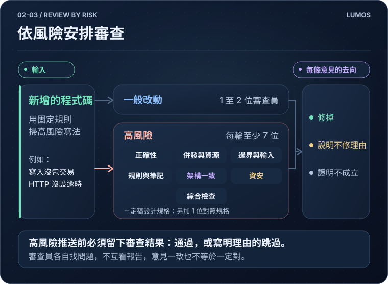
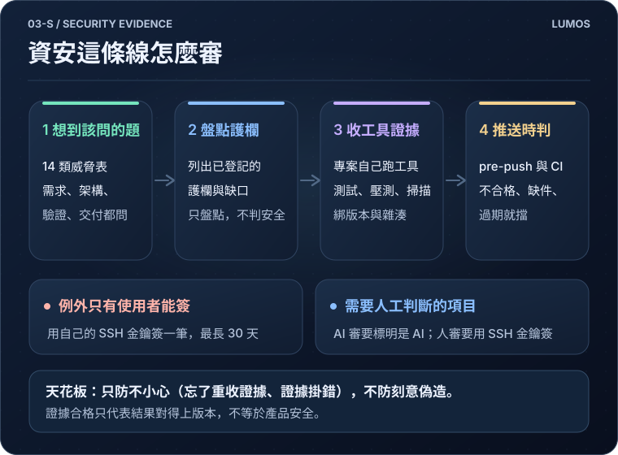
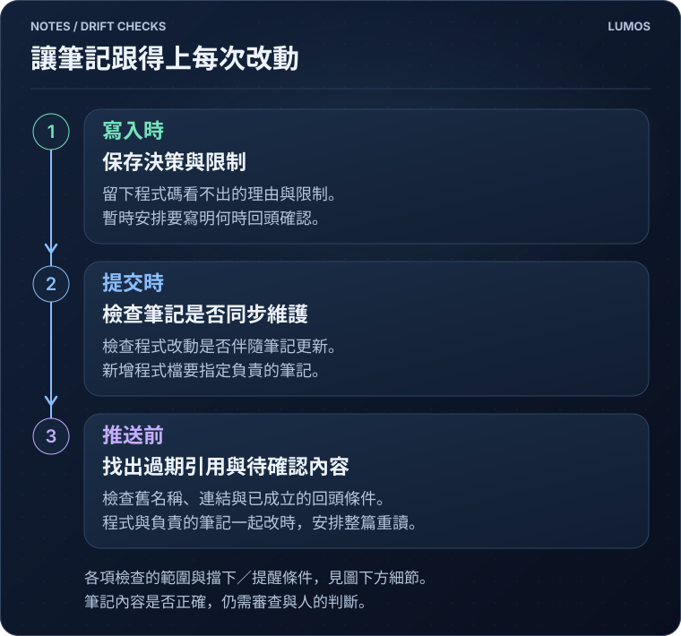
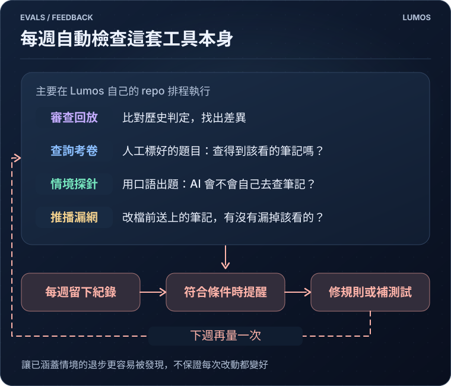

<p align="center">
  <picture>
    <source media="(prefers-color-scheme: dark)" srcset="assets/lumos-logo-dark.png">
    
  </picture>
</p>

# Lumos

**繁體中文** · [English](README.en.md)

[](https://github.com/EnzoHsieh-Android/Lumos/actions/workflows/ci.yml)

**用 AI 改程式時，把當初的理由和驗證結果一起留在專案裡。**

Lumos 是裝在 Git 專案裡的一套開發工具，搭配 Claude Code 或 Codex 使用。你照常跟 AI 討論需求；Lumos 提供工作守則、查筆記的指令，以及提交和推送時會執行的檢查。

它想解決的是接手時常碰到的問題：程式還在，當初的討論卻找不到了。

例如，一個 API 同時回傳新舊兩個欄位。接手的人可能想刪掉舊欄位，但它其實是為了還沒升級的客戶設備而保留。光看程式，未必知道是哪個客戶還在用、要等什麼條件才能刪。這些理由如果只留在某次對話裡，換個人或換個 AI，就得重新查一次。

Lumos 要求 AI 把這類理由寫成 Markdown 筆記，連同審查與測試紀錄放進版本控制。下次改到相關程式時，就能一起查閱。這適合會持續維護、經常交接的專案；代價是每次改動多了記錄、檢查與審查的時間，多位 AI 審查員也會增加模型用量。

[看一次使用流程](#use) · [安裝與第一次使用](#start) · [深入了解各項檢查](#mechanisms)

<a id="use"></a>

## 用起來是什麼樣子

以下是使用情境示意，沿用前面的 API 例子。你可以這樣交代 AI：

> 新版客戶端已改用新欄位，請整理這支 API。先查一下舊欄位為什麼還留著；不確定能不能移除的地方，先問我。

AI 先讀程式，再查相關筆記。如果筆記記著「某批設備還沒升級」，它就有理由向你確認，而不是只憑兩個欄位看起來重複就刪掉。你決定怎麼處理後，AI 再修改程式、執行相關測試，依改動風險安排審查，並把結果寫回專案。

一次工作結束時，你可以查看程式改動、決策筆記、審查報告和測試紀錄。以這個例子來說，接手的人應該能查到：舊欄位為誰保留、何時能移除，以及這次測了哪些新舊客戶端情境。

**這些工作由 AI 依守則執行；Lumos 的指令和 Git 檢查負責協助查詢、核對紀錄，必要時擋下提交或推送。** 有筆記不代表理由正確，有測試紀錄也不代表功能一定沒問題，內容仍需要審查。

<details>
<summary>看實際輸出：AI 改了程式，卻忘記更新筆記時</summary>

以提交時那道關卡為例：假設 AI 改了退款邏輯，卻沒寫任何筆記就提交，它會收到這段訊息（實機輸出，節錄）：

```text
$ git commit -m "feat: 退款前檢查是否已退過"

擋下:這次 commit 改了程式碼,但知識筆記一個字都沒動。
…
這次改到的程式碼(1 個):
   • src/payment.py
…
兩條路選一條:
   1. 把該改的筆記改一改,加進 commit,再提交一次。
   2. 這次真的不需要動筆記(改錯字、排版、註解、還在進行中的半成品)→ 跳過這道檢查:
        git commit --no-verify -m '<訊息>'
      跳過會留下紀錄,不是偷偷放行。
```

這段訊息是給 AI 讀的：守則要它補好筆記再提交；真的不需要（例如只改錯字）也能跳過，但會留下紀錄。你主要負責業務取捨，和要不要接受某個風險。

</details>

## 怎麼運作

<p align="center">
  <a href="assets/map-zh.svg">
    
  </a>
</p>

1. **讀程式碼，補上脈絡**：AI 先讀程式碼；改檔時，工具會送上相關筆記，補上程式碼看不出的理由。筆記講的程式行為跟程式碼對不上時，以程式碼為準；部署狀態、業務限制這類程式碼答不了的，要查證或問人。
2. **依風險派 AI 審查**：見下面「怎麼做 code review」。
3. **每項審查意見都要有處理結論**：修掉、說明不修的理由，或用證據證明不成立；每項意見都完成處置，才符合這道關卡的放行條件。
4. **寫回筆記**：把這次的取捨和驗證方式寫進負責這支檔的筆記，下次改到這裡查得到。

外圈檢查流程本身，見下方「怎麼持續改進這套工具（evals）」。

## 人在哪裡介入？

Lumos 預設不要求人逐行看 diff，交給 AI 和自動檢查；人負責這些判斷：

- 需求、取捨、要不要接受風險，以及不可逆的操作。
- 審查跑滿 3 輪還沒過：standard 或 high 分級的審查（設計審、代碼審都算）會停下交給人，決定加輪或接受風險，AI 不能自己宣布通過。
- 規則還符不符合業務，要人簽核並留紀錄，這是測試證明不了的。

每輪的審查報告和處理結果都留在 repo，隨時可以抽查。

<details>
<summary>細節：如何記錄人工裁定與回顧</summary>

- 人的裁定用 `lumos loop cap-decision` 記下。
- 繼續之前，用 `lumos loop retro` 記一份合格的回顧，或留下有理由的略過紀錄；人的裁定記下後兩樣都沒有，就不能再記後續的審查紀錄，也過不了「每條審查意見都已處理」那道關卡。

</details>

<a id="start"></a>

## 安裝與限制

需要 Git、Python 3.14 以上，以及 Claude Code 或 Codex。下面的指令會下載安裝腳本並執行；請在要導入的專案目錄執行：

```bash
curl -fsSL https://raw.githubusercontent.com/EnzoHsieh-Android/Lumos/release/get.sh | bash
```

**版本範圍：本 README 描述 `main`；上述一鍵安裝預設取得 `release`。** 兩條分支可能不同步，安裝後請核對工具來源與版本，不能假定已包含 main 的全部更新。[10/1–10/7](docs/updates/2026-10-07-readme-audit.md) 與 [10/7–10/10](docs/updates/2026-10-10-readme-audit.md) 兩份更新清點，列出每次盤點涵蓋的提交、補了哪些文件，以及盤點當時 main 和 release 差在哪裡。

腳本問要不要初始化目前目錄時，確認目錄正確再輸入 `y`。裝完重開一個 AI 對話，執行 `lumos enforcement` 查看檢查是否接上。Codex 的信任核可狀態無法由本機讀取，仍要依提示確認並實際觸發一次 hook。Windows、離線安裝與移除見[上手細節](ONBOARDING.md)。已經在用的專案要升級時，可以先跑 `lumos update --dry-run`，預覽會改哪些規範檔與工具檔，不會真的動手。

<details>
<summary>已經在用舊版的專案：升級到 Python 3.14 要做的事</summary>

- 更新後，沒有 3.14 的機器，提交與推送會被擋下並說明怎麼裝（macOS：`brew install python@3.14` 或 `uv python install 3.14`）。`python3` 指到舊版沒關係，lumos 會自己找 3.14 重跑。
- 專案 CI 要把 `actions/setup-python` 設成 3.14。
- 裝好之後跑一次 `lumos install`，讓 Claude／Codex 的 hooks 也改用 3.14。
- Codex 的 hook 指令因此改變，可能要再開一次互動式 codex 重新核可。本機讀不到 Codex 的信任狀態，請跑 `lumos enforcement`，再實際觸發一次 hook，確認它真的會執行。

</details>

Lumos 不保證品質或安全，也不取代工程判斷：筆記可能過時，AI 審查可能漏判，有紀錄不代表內容正確。業務取捨、不可逆的操作和要不要承擔風險，仍由人決定。

第一次使用，可以先挑一個範圍小、預期結果清楚的修改，在新的 AI 對話裡交代：

> 請先讀這個專案的工作守則，再幫我修改［具體需求］。完成後告訴我改了什麼、跑了哪些檢查，以及相關筆記和審查紀錄在哪裡。

先看一次完整的結果，再決定要不要用這套流程維護更多功能。


<details>
<summary>工具組成與 Claude Code 專用外掛</summary>

概念上，它把 ADR（架構決策紀錄）、CODEOWNERS 的檔案歸屬概念，以及 pre-commit 的提交檢查，串進 AI 的開發流程。目標是讓人從決策、審查與驗證紀錄掌握改動，把注意力放在需求與風險判斷上。

核心工具是一支單檔的 Python 命令列工具（只用標準函式庫）、一組 Git hooks、一份寫進 CLAUDE.md／AGENTS.md 的 AI 工作守則，加上專案筆記。

<details>
<summary>Claude Code 專用的三個外掛</summary>

- 一個記錄會談裡發生的事件，可用 `lumos events` 查詢。
- 一個在對話被壓縮時，要求留下接手工作需要的狀態。
- 一個限制被標成審查員的 AI 能用哪些工具、能直接寫進哪些位置。這不是安全沙箱：它的 Bash 仍能執行完整的 shell。

這三項目前沒有對應的 Codex 外掛。

</details>

</details>

<a id="mechanisms"></a>

## 深入了解各項檢查

下面各節先說用途。想看圖、判定條件或操作指令時，再展開細節；第一次閱讀不必把它們全部看完。

## 從計劃到驗證，讓筆記一步步連起來

筆記放在專案的 `docs/<專案>-knowledge/` 裡，可以直接用文字編輯器閱讀。計劃、功能說明、驗證和事故各自成篇，再用連結串起來；README 裡說的「圖譜」就是這些互相連結的筆記，「節點」就是其中一篇。

例如前面的 API 相容安排，筆記要留下的是「為誰保留舊欄位、移除前要確認什麼」。新舊欄位目前怎麼回傳，直接看程式即可。展開後的圖是筆記關係的示意，不是另一個需要操作的圖形介面。

<details>
<summary>看筆記如何連結，以及重要規則怎麼驗證</summary>

互相連結的筆記合稱「圖譜」，每篇是一個「節點」，分成計劃、功能說明、驗證紀錄和事故。下圖以虛構的線上商店為例：

- **從計劃到驗證**：先寫結帳與付款串接的計劃，做出功能，再留下端對端測試和重複付款壓力測試的驗證紀錄。
- **出事故時**：發生「取消訂單未退點」，事故連回結帳流程，接著開修復計劃、修正功能、補上回歸測試。
- **重要規則怎麼守**：把規則寫成標有 ★INVARIANT★ 的一行（稱為「合約行」），綁上檢查它的測試，再交給沒參與這件工作的 AI 獨立審計。也可以用 `lumos guard` 在隔離的副本裡故意弄壞程式，確認測試真的會失敗。

圖上的金環只是示意，表示那篇筆記記了必須遵守的規則、也連到了驗證紀錄；工具裡沒有「受保護」這種狀態。

<p align="center">
  <a href="assets/graph-demo-zh.svg">
    
  </a>
</p>

</details>

## 怎麼做 code review

審查員是另外開啟的 AI，讀這次改動和相關資料，從不同角度找問題。一般改動安排一到兩位，高風險改動則增加到每輪至少七位，因此會花更多時間和模型用量。

每條意見都要有結論：修正、附理由不修，或提出反證。文中的「閘門」指的是決定能不能繼續的檢查；有些是程式自動擋下，有些是要求 AI 遵守的工作規則，兩者的範圍在下方分開說明。

<details>
<summary>看風險分級、審查圖與修補驗證</summary>

<p align="center">
  <a href="assets/risk-review-zh.svg">
    
  </a>
</p>

- **先判風險**：推送前用固定規則掃這次新增的程式碼，找容易出事的寫法。
- **再決定派幾個 AI**：一般改動 1 到 2 個；高風險每輪至少 7 個，5 個找問題、1 個看架構一致、1 個看資安，有定稿的設計規格時再加 1 個對照規格。
- **高風險要有審查結果才能推**：推送前要留下審查結果（通過，或寫明理由的跳過），否則 Git hook 會擋下。

**修好一個問題，也要確認沒有弄壞原本正常的功能。** 修正後的那一輪，工作指引要求：

- **固定修正前、後兩個版本**：重現原問題的測試要修正前失敗、修正後通過；原本正常的行為要在兩個版本都正常。
- **由全新、沒有前輪脈絡的 AI 審查員重新檢查**：檢查修補有沒有副作用。
- **修補混了重構時**：保留分段的驗證點；部分高風險案例還要抽查，確認測試抓得到功能退化。

`lumos loop fix-check` 會檢查修正紀錄和修正後的測試，但目前只提醒，不取代上面這些驗證，也不取代下一輪審查。審查材料裡的引用、快照和紀錄也會先核對，避免拿不完整的證據當通過依據。詳見 [代碼審工作指引](skills/lumos-code-loop/SKILL.md)。

</details>

### 資安怎麼審

資安護欄是針對具體風險登記的防護，例如「只有訂單擁有者能查看訂單」。登記後，專案執行測試或掃描工具，Lumos 再核對結果是否符合要求、是否對應目前版本。**沒有登記的專案，這道閘不會檢查資安。**

這套檢查主要避免漏做或拿錯證據，不能證明產品安全，也擋不住刻意偽造紀錄。需要人負責的核可，仍要由人決定。

<details>
<summary>看資安流程圖、登記方式與核可限制</summary>

業務規則（★INVARIANT★）記錄必須遵守的約定；資安防護另行登記與驗證，方便查出哪些項目仍缺少證據。驗證不能只靠填表，還需要符合該類防護要求、且對應目前版本的證據。

<p align="center">
  <a href="assets/security-lane-zh.svg">
    
  </a>
</p>

- **先登記才會判**：資安護欄要登記在功能筆記裡（寫法見[資安護欄手冊](skills/lumos-project-notes/commands/10-資安護欄.md)）；守則要求 AI 碰到登入、權限、付款、個資這類功能就登記。**沒登記的專案，推送閘整個不判資安。**
- **想到該問的資安問題**：AI 照守則寫計劃時，需求、架構、驗證、交付四個階段的提問裡都有資安題，題目來自一張 14 類的威脅類別表；不是自動彈出，要 AI 照守則去叫。
- **盤點護欄**：`lumos security list` 列出專案登記了哪些資安護欄、哪些入口還沒有護欄。它只盤點、不執行測試，盤點完成不等於安全。
- **證據要是工具真的跑出來的**：閘門自己讀測試、壓測、掃描工具的輸出，判合不合格；程式改了沒重收證據，就算過期。
- **本機與 CI 都核對證據**：本機 pre-push 在推送前阻擋不合格、過期或缺件的證據；CI 在推送後檢查，失敗時回報不通過。
- **例外放行須由使用者簽核**：要暫時放行，使用者用自己的 SSH 金鑰簽一筆核可，最長 30 天到期。
- **需要人工判斷的項目要留審查紀錄**：AI 審的要註明審查者是 AI，而且不能代替該由人負責的核可；人審的要使用者用自己的 SSH 金鑰簽過才算。
- **工具由專案自己裝、自己跑，lumos 只讀結果**：AI 不自行安裝，每個工具要用之前都要使用者核可。

<details>
<summary>細節：威脅表、證據種類、核可紀錄、工具核可</summary>

- **威脅表涵蓋**：物件授權、身分驗證、注入、流程濫用、資料外洩、對外連線、秘密管理、供應鏈、稽核紀錄等，對照 STRIDE、OWASP ASVS 5.0.0、WSTG、API Top 10。表的核可與改版由 Claude 與 Codex 兩家各自獨立審、意見一致才升版。
- **盤點還列什麼**：`lumos security list` 也列出每條護欄的證據核對到哪；`--questions` 依沒蓋到的格子出候選題。結果固定標 `not_assessed`。
- **證據種類**：每條護欄依類別要求最低證據種類：JUnit 測試、故障注入（guard kill）、k6 壓測與並發摘要、SARIF 掃描結果（例如 Semgrep、gitleaks、OSV-Scanner、ZAP）。掃描類另要一份「真的有掃到東西」的覆蓋證明。報告綁版本與雜湊。`lumos security evidence` 和推送時的證據檢查用的是同一套判定程式。
- **推送閘的範圍**：凡是接了 lumos 的專案，pre-push 與 CI 的 `code-loop check` 都會判，tag 推送也判。
- **核可紀錄**：記在只追加的 `.lumos/security-approvals.jsonl`。
- **工具核可**：工具裝在導入 Lumos 的專案裡，由那個專案執行，並把輸出存進版控；lumos 本身維持零依賴。k6、gitleaks、OSV-Scanner、Semgrep、ZAP 這類工具，每個專案要用之前由使用者逐項核可安裝來源、釘版本、時間預算與准打目標。

</details>

這層檢查的適用範圍與限制如下：

- **只防不小心，不防刻意偽造**：照「信賴原則」，照常操作的 AI 假定誠實；閘防的是忘了重收證據、證據掛錯、殘留設定，擋不住 AI 刻意自產金鑰自簽或直接手寫核可檔。
- **`--no-verify` 跳得過本機閘**：CI 在推送後才紅，收不回已進主線的提交。
- **證據合格不等於產品安全**：工具收證一致只證明結果對得上版本，不證明判準選得對或報告可信。

審查只是其中一層。風險分級、AI 審查、放行規則、外部規則（linter）和測試各有漏洞，疊在一起，問題就難一路穿過，這就是瑞士起司模型。

<p align="center">
  <a href="assets/swiss-cheese-zh.svg">
    
  </a>
</p>

</details>

## 測試要有用，不能只是把程式碼重寫一次

測試全綠，可能只是程式和測試犯了同一個錯。Lumos 的工作指引要求先從需求確認預期結果，再驗證程式被改壞時，測試是否真的會失敗。這是寫測試與審查的要求，工具不能代替人判斷預期答案是否正確。

<details>
<summary>看測試例子與檢查工具</summary>

**測試全綠，不等於功能正確。** 如果測試用和正式程式一樣的算法算出預期值，兩邊犯同一個錯還是會過；如果只檢查原始碼含有某個函式名稱，實際行為壞了也可能照樣綠。

例如需求是「3 件商品，每件 5 元，總價應為 15 元」：

```python
# 壞例：把實作的算法再寫一次，無法獨立判斷算法是否符合需求
expected = quantity * unit_price
assert total_price(quantity, unit_price) == expected

# 好例：用已確認的需求案例，檢查實際結果
assert total_price(quantity=3, unit_price=5) == 15
```

這個案例只是起點；折扣、空訂單與錯誤輸入等行為仍要依需求補齊。Lumos 要求開發時先說清楚「輸入、預期結果、判準來源、應抓到的錯誤」，修 bug 與關鍵守衛還要確認故障真的能讓目標斷言翻紅，再還原跑綠。檢查程式結構、各部分有沒有正確接上的測試可以留著，但不能取代對實際行為的驗證。

**能抓到程式被改壞，不等於預期答案正確。** 程式和測試可能一起抄錯需求，所以要先拿獨立的來源核對預期答案，再確認：弄壞相關程式時測試會失敗，還原後會通過。如果懷疑某個行為測試綁死了特定寫法，還要確認重構（不改變行為）之後它仍然通過。各語言的測試撰寫流程、工具驗證案例與證據適用範圍見 [測試品質接入標準](skills/lumos-project-notes/commands/test-quality-standard.md)。

完整做法見 [實作測試品質](skills/lumos-project-notes/commands/03-寫回圖譜.md#實作測試品質)，開發與審查工作指引共用這份規範。這些是開發與審查的要求；自動檢查會核對紀錄格式，但不能替人判斷測試是否真的有用。

<details>
<summary>輔助工具：<code>lumos test-quality</code></summary>

- **`scan`**：裝好 Lumos 後，`lumos test-quality scan <測試檔或目錄> --json` 會以唯讀方式列出可疑的測試寫法，供人進一步檢查。Python 能找四類可疑寫法；其他語言（含 PHP）可選用本機的 Semgrep，找出「拿一個值跟自己比較」這類斷言。
- **`capture`**：在你明確指定時執行本機可信的測試程式，保存 JUnit 結果與原始碼快照。
- **`check`**：核對「正常→弄壞→還原」三段的證據，也可以加上重構前後的證據。
- **限制**：**沒找到可疑寫法、測試全部通過，或成功抓到刻意引入的錯誤，都不能單獨證明預期答案正確。** 工具不提供沙盒、不替代需求來源審查；先用 `capabilities` 看範圍，再讀 [操作與能力邊界](skills/lumos-project-notes/commands/03-寫回圖譜.md#事後掃描與執行收證已安裝-cli)。

</details>

</details>

## Android：在實機上驗效能與記憶體

Android App 改完之後，Lumos 在真的手機或平板上確認兩件事：**有沒有變慢**、**有沒有吃掉記憶體不還**。發現問題就一層一層往下查，直到指出是哪個函式、哪一行造成的；每一步都寫成查證紀錄，別人拿到同一批原始資料照著重跑，會得到一樣的結果。

其中「讀效能紀錄、找出卡在哪」這一步，直接照 Google 官方公開的 [android-profiler skill](https://github.com/android/skills)（寫給 AI 看的分析步驟說明）來做，不自己另編一套。Lumos 負責官方 skill 以外的串接：判斷到底有沒有變慢、要不要往下查，把各層工具接起來，分辨問題出在哪一種畫面寫法，抓出第三方套件忘了釋放的記憶體，並把過程寫成可重跑的紀錄。

<p align="center">
  <a href="assets/android-e2e-zh.svg">
    
  </a>
</p>

<details>
<summary>看每一層在做什麼、實驗結果與限制</summary>

**像看病一樣分層：先量體溫，有發燒才抽血，抽血有問題才照片子。** 不一開始就把所有工具全開，因為有些工具本身會讓 App 跑起來不一樣，記憶體快照還可能拍到使用者資料；沒問題卻全部都錄，等於每次都付最高的代價。

| 層 | 要回答的問題 | 怎麼查 | 什麼情況才往下 |
|---|---|---|---|
| L0 | 有沒有變慢？有沒有達到約定的標準？ | 跑 Google 的效能測試工具 Macrobenchmark，再用 `lumos macrobench` 跟上次存的基準比，並對照人訂的標準 | 比基準慢、或沒達標 |
| L1 | 卡在哪？是忙著計算，還是在等別人？ | 每次測試都會留下一份逐毫秒的執行紀錄（Perfetto Trace），照 Google 官方 skill 的步驟讀它；同時算出時間花在新式（Compose）還是舊式（XML）的畫面寫法上 | App 自己在忙著算 → 往下；是在等別的程式或檔案 → 留在這層，順著追是誰讓它等 |
| L2 | 是哪個函式、哪一行？ | 用 simpleperf（Android 附的效能抽樣工具）每毫秒記一次「現在在跑哪段程式」，次數最多的那一行就是兇手；查完把手機設定還原 | 那一行在大量建立物件 → 往下 |
| L3 | 誰在佔記憶體？為什麼一直不釋放？ | 用 Perfetto 附的 `heap_profile` 看誰在大量配置記憶體、`java_heap_dump` 拍記憶體快照，找出是哪個變數一直抓著那些東西 | — |

**各層用的工具一覽。** L0 是 Google 的效能測試函式庫 Macrobenchmark，加上 `lumos macrobench` 判定；L1 是 Google 的系統追蹤工具 Perfetto 錄下的紀錄，用它的查詢工具 `trace_processor` 照官方 skill 讀；L2 是 Android NDK 附的 simpleperf；L3 是 Perfetto 附的 `heap_profile` 與 `java_heap_dump`。

**為什麼用 Google 官方的 skill。** 讀效能紀錄的步驟由 Google 維護，會跟著它的工具一起更新，比我們自己寫一套可靠。我們把 skill 和每個工具各自固定在一個版本，升級時要重新驗過；這樣今天查到的結果，日後照同一份紀錄重跑還是對得上。

**記憶體：專抓「第三方套件有提供釋放的方法，App 卻忘了呼叫」。** 例如播放器、地圖這類套件，關掉畫面時要呼叫 release，忘了就會一直佔著記憶體。專案自己寫的操作測試（驅動指令寫在專案的設定檔裡；目前驗過的是 Android 的 UI Automator，Maestro 規劃之後接上）會在手機上反覆打開又關掉同一個畫面，Lumos 的收集腳本在旁邊收資料，再由 `lumos macrobench` 判斷七件事（每一項都要在專案的標準檔裡寫一條才會判）：

- C/C++ 那一側有沒有記憶體已經沒人在用、卻沒被釋放（用 Android 內建的 `dumpsys meminfo --unreachable`，暖機跑完之後與量測跑完之後各掃一次）。
- 某些物件的數量是不是越開越多（用 Perfetto 的 `java_heap_dump` 在暖機跑完之後與量測跑完之後各拍一份快照，再用 `trace_processor` 數每種物件；要先宣告只用測試資料才會拍）。
- 指定的物件關掉畫面後還剩幾個（同上一項的第二份快照）。
- 記憶體用量最高到多少（開關期間用 Perfetto 全程錄製，再用 `trace_processor` 算最大值）。
- App 有沒有閃退或被系統強制關掉（用 Android 內建的 `dumpsys activity exit-info` 讀前後兩次的結束紀錄，並比對行程有沒有換過）。
- 系統內建的檢查（StrictMode）有沒有抓到資源沒關、註冊沒取消、畫面被留住這類違規（開關期間用 `adb logcat` 收這個 App 的日誌，只留違規那幾行）。這項要兩件事都做：專案在測試版自己打開 StrictMode，並在設定檔宣告有打開；沒宣告就列成跳過。宣告了卻沒真的打開，會因為一筆違規都收不到而被誤判成通過。
- 畫面有沒有卡住超過 0.7 秒（同一份 Perfetto 錄製裡的每幀時間）。

前四項（記憶體類）沒過時，會直接跳到 L3：中間兩層看的是 CPU 花在哪裡，記憶體問題在那裡看不出來；不過專案要先宣告只用測試資料，沒宣告就停在 L0 並記下缺口。畫面卡住照一般流程從 L1 查；閃退與 StrictMode 違規則直接看收集到的結束紀錄與日誌。

**每一步都寫進查證紀錄。** 手機型號與狀態、安裝的 App（用檔案指紋比對）、每一條查詢與預期結果、為什麼要往下一層，全都放在同一個資料夾，附一支 `rerun.sh`，可以對同一批原始資料一鍵重跑每條標了預期結果的查詢、比對結果；原始資料只留在本機，不進版控。提交前會另外找一個完全不知道前因後果的 AI，只看這份紀錄重新判斷每個結論；它判斷不出來，就代表紀錄寫得不夠清楚。

**實驗結果**（用一台 Samsung 平板（型號 SM-X710），和一個刻意埋了問題的小 App）：

- 清單每畫一列就故意多等 8 毫秒：L0 報出畫面變慢（畫面每重畫一次叫一幀；較慢的那一成幀，每幀花的處理器時間從 4.3 毫秒變成 10.4 毫秒），L2 直接指到實驗 App 的 `MainActivity.kt` 第 36 行。
- Java 寫的第三方套件，關畫面時沒呼叫 release：多留下 5 個物件，L3 查出是被套件自己內部的清單抓著。
- C/C++ 寫的第三方套件沒呼叫 release：多佔 10 MB（開關 5 次、每次 2 MB），指到是哪個套件檔，以及 App 裡哪個函式建立它。
- 三種畫面寫法造成的變慢，都被分到對的類別並指到函式；另外找一個不知道埋了什麼的 AI，只看量測資料，三種都找到了問題所在。

**目前的限制。**

- 只在一台平板、一個實驗用 App 上驗過，數字不代表正式 App；換了手機品牌，工具的行為可能不同。
- 只提醒、不擋推送：毫秒數字會隨手機和溫度浮動，不適合當成硬性關卡。
- 記憶體快照預設不錄：專案要先寫下「誰、在哪一天同意只用測試資料跑」，才會錄；快照只放在本機，之後每次跑收集腳本會順手刪掉超過 7 天的，不再跑就不會自動刪，用完要自己刪。
- 判斷「算不算變慢」的容許誤差目前是暫定值（預設 10%，另有 1 毫秒的下限），之後會用多次實機重跑的資料重訂。
- 效能、記憶體已經接進下面的「實機驗收」；單獨跑 `lumos macrobench` 時照舊只提醒。

**怎麼開始用：** 在 Android 專案跑完 Macrobenchmark 後執行 `lumos macrobench`（第一次加 `--update-baseline` 存成基準）；它報出問題時，請 AI 照 `lumos-android-evidence` skill 一層一層查。設定檔與標準的寫法見 [Macrobenchmark 驗收門檻](docs/lumos-toolchain-knowledge/Projects/Macrobenchmark驗收門檻_計劃.md) 與 [記憶體與穩定性驗收](docs/lumos-toolchain-knowledge/Projects/Android記憶體與穩定性驗收_計劃.md)。

</details>

### 實機驗收：開發中按功能跑，推之前整套跑（端到端驗收）

**同一支腳本，開發中只跑你正在做的那個功能、甚至只跑它的一個使用情境；推之前把 App 從頭到尾驗一遍，結果寫成一份查證紀錄；推送前會擋沒驗過的版本，這次改到的功能都按功能跑過、通過也算。** 每個使用情境可以有四樣東西：照 Maestro（一種用文字寫好「點哪裡、輸入什麼」的畫面自動操作工具）的流程檔實際點一遍、拍畫面跟人看過的基準圖比、跑效能測試、反覆開關畫面看記憶體與穩定性。每次跑都先建置並安裝 App，跑完由 `lumos android-e2e judge` 判過不過。

```
sh scripts/templates/android-e2e-run.sh --changed                  # 開發中：看這次改到的檔，只跑對應功能的使用情境
sh scripts/templates/android-e2e-run.sh --feature player           # 只跑這個功能的全部使用情境
sh scripts/templates/android-e2e-run.sh --case player.open-close   # 只跑這一個使用情境（加 --no-perf、--no-memory 可略過效能或記憶體）
sh scripts/templates/android-e2e-run.sh                            # 整套跑一次，寫查證紀錄
lumos android-e2e history                                          # 看最近 20 次檢測的紀錄（可加 --feature、--case 篩，--last 改筆數）
lumos android-e2e check                                            # 推之前先看推送前檢查會不會擋、為什麼
```

<p align="center">
  <a href="assets/android-acceptance-zh.svg">
    
  </a>
</p>

<details>
<summary>看怎麼接、結果怎麼讀、實驗結果與限制</summary>

**怎麼接。** 在專案的 `.lumos/macrobench.json` 加一段 `e2e`：哪些目錄算 App 程式、怎麼建置、APK 在哪、要跑哪幾支流程檔；截圖比對、記憶體與穩定性、效能三塊各自要開才會跑。截圖比對用 [maestro-visual-toolkit](https://github.com/EnzoHsieh-Android/maestro-visual-toolkit) 先裝進專案、錄好基準圖。`lumos update` 會把驗收腳本裝進專案的 `scripts/templates/`。寫法見 [Android 端到端驗收](docs/lumos-toolchain-knowledge/Projects/Android端到端驗收_計劃.md)。

**功能對照表。** 在 `e2e` 段加 `features`：每個功能寫它管哪些程式路徑（`--changed` 靠這個從改到的檔找出功能）、有哪些使用情境，每個情境列它的流程檔、截圖畫面、效能測試方法、記憶體情境。效能指令裡寫 `{{TEST}}`，會換成挑到的測試方法；記憶體情境寫在最外層的 `stability_scenarios`，一個情境一個開關畫面的驅動。對照表寫了不存在的流程檔或情境，檢查設定時就擋下。大家共用的程式（網路層、共用元件、`Application`）列進 `e2e` 段的 `shared_paths`：推送前改到它們就要整套跑（要在 `app_dirs` 底下；寫在外面的模組要先加進 `app_dirs`）。

**兩種分塊。** 開發中可以只跑一部分，分兩個方向切，兩個方向可以疊著用：

| 切法 | 怎麼叫 | 跑什麼 |
|---|---|---|
| 按功能 | `--changed`（看改到的檔）、`--feature <功能>`、`--case <功能.情境>`；多個用逗號連起來 | 只跑挑到的情境列的流程檔、截圖、效能方法、記憶體情境 |
| 按檢測 | 再加 `--no-perf`、`--no-memory`（只能配上面的挑法；整套跑一定全部跑） | 略過效能或記憶體與穩定性，那幾個情境的紀錄標「不完整」 |

例如 `--case list.scroll --no-perf --no-memory` 只跑那個情境的 UI 流程與截圖，幾十秒就有結果。一個情境如果只列了效能、或該跑的都被略過了，沒有會判過不過的項目，就記成「沒判完」、回 1，不會當成通過。

**推送前會擋。** 推送前的檢查從被推送的提交裡讀這一版的查證紀錄（所以紀錄要先提交）：整套跑過且通過就放行；沒有整套結果時，看這次改到的檔各屬於哪個功能，那些功能的每個情境都按功能跑過、通過也放行，終端會多印一行「按功能放行」。改到 `shared_paths`、對不到任何功能的檔、或改了驗收設定本身，就要整套跑。擋下時終端會印要跑的那一行指令；擋下訊息有印放行指令、又確定是誤擋時，照它印的放行指令（有些擋下不印，例如設定不合格、找不到主線或分岔點、逾時、紀錄讀不懂或太大、這一版沒有或拿掉了驗收設定；那些照它說的處理） `lumos android-e2e waive <指紋> --commit <提交> --note "<理由>"` 放行：在終端答 y 算人放的，沒有互動終端時算 AI 放的，推送、`lumos doctor` 與開場提示（有知識圖譜的專案）會一直列出來，直到人用 `lumos android-e2e waive --ack --all` 看過。只想這一次整道先不跑：`LUMOS_SKIP_ANDROID_E2E=1 git push`（會記帳）。沒用端到端驗收的專案，這道檢查一行都不印。

**在筆記裡分出使用情境、綁上測試。** 功能對照表管「跑什麼」，圖譜筆記管「這個情境為什麼要成立、改了會壞什麼」，兩邊用同一個情境名對上：

- 一個功能一篇 Systems 筆記（那個功能的程式的家）；每個使用情境在摘要寫一行合約，例如 `KEY:★INVARIANT★ 清單打開就看得到第一列 [test:ui:list_first_row]`。不確定是不是合約就不要標，改在正文寫一句指向那支流程檔。
- `[test:ui:<名>]` 的 `ui` 是平台名：在 `.lumos/config.json` 的 `platforms` 加 `"ui": {"profile": "maestro", "root": "."}`（平台超過一個時另寫 `default_platform`）。`<名>` 對的是流程檔 yaml 裡的 `name:`，要用英文字母或底線開頭（例 `name: list_first_row`），中文開頭的名字認不出來。
- 同一支流程檔也列進功能對照表那個情境的 `flows`。目前兩邊沒有機器連起來，靠同一個情境名與同一支流程檔對上；改情境時兩邊一起改。

**兩種紀錄。** 每一次跑（整套或按功能、過或沒過、被中斷、判定擋下沒寫紀錄）都記進本機的檢測總表 `.lumos/artifacts/android/history.jsonl`：時間、哪一版、有沒有沒提交的改動、挑了哪些使用情境、每一項的結果、證據放在哪。從開跑到判讀工作目錄都乾淨、版本沒換時，結果也寫進這一版的查證紀錄：整套跑記在 `runs`，按功能跑把那幾個使用情境記在 `feature_runs`（一個情境一筆；略過情境本來有的效能或記憶體、或只列了效能沒有會判過不過的項目時標「不完整」，這次沒過一律蓋掉先前的結果，這次沒判完、或不完整但通過時才保留同一版既有的完整結果）。查證紀錄綁在「這一版 App 程式與驗收素材」上：之後改了 App 程式、流程檔、基準圖或門檻任何一處，這份紀錄就不算數，要重跑。

**為什麼要先提交。** 查證紀錄要綁在某個提交上，所以整套跑時工作目錄有沒提交的改動會拒跑；按功能跑則照跑，但開跑時有沒提交的改動就只記總表（建出來的 App 不是這一版，跑到一半才收掉改動也一樣）。跑到一半換了版本，也不寫紀錄。順序是：改程式 → 提交 → 跑驗收 → 把紀錄另外提交。

**結果怎麼讀。**

- **通過**：整套跑時紀錄寫好了，提交它再推送；按功能跑時看終端最後一行有沒有寫進紀錄（開跑時有沒提交的改動就只記總表）。效能變慢只會多印提醒，照樣算通過。
- **沒過**：只要有一塊沒過就是沒過，終端會印是哪一塊。UI 流程沒過附報告路徑、截圖沒過附相符率與差異圖，直接看那份；記憶體沒過時原始數字在這次的產物目錄：`stability` 段本身在 `.lumos/artifacts/android/<run-id>/stability.json`，其他記憶體情境在旁邊的 `<run-id>.<情境>/stability.json`，照上面的分層查證往下找。每個情境各留一份錄製檔，不會自動清，舊的要自己刪。
- **沒判完**：沒有一塊沒過，但有一塊沒跑成，例如建置或安裝失敗，或跑到一半被中斷（中斷時仍會寫下這份紀錄）。這是環境的問題，修好再跑。
- **沒寫紀錄**：開跑前檢查就停下了（設定不合格、整套跑時工作目錄有沒提交的改動、要跑記憶體那塊卻缺 Perfetto 工具、`--changed` 對不到任何功能），或跑到一半換了版本。修好再跑。

UI 流程失敗會自動重跑一次，兩次都失敗才算沒過。效能這塊照舊只提醒、不擋，原因跟上面一樣：毫秒數字會浮動。

**截圖比對沒過、而且畫面是你故意改的，要換基準圖，不要降門檻。** 換基準圖等於重新定義「這畫面是對的」，所以要人看過新圖才換（toolkit 的 `visual-record.sh`），再重跑驗收。

**實驗結果**（同一台 SM-X710 平板、同一個實驗 App）：

- 四塊全開時整套通過，一次約 3 分鐘（建置有快取、效能只跑 5 輪；效能照建議跑 20 輪會再多幾分鐘）。
- 分塊執行（同一台平板）：只跑清單情境的 UI 與截圖約 33 秒，只跑播放器的記憶體情境約 43 秒，清單情境連效能約 2 分鐘；`--changed` 改清單的程式只挑到清單情境；略過效能、記憶體的那幾次都記成不完整，沒蓋掉同一版先前完整的結果；播放器情境只有記憶體，帶 `--no-memory` 就記成沒判完、回 1。清單的效能測試偶爾自己失敗（滑到第二次就到底），只提醒、不影響通過，重跑一次就過。
- 故意讓 App 關畫面時不釋放 C/C++ 套件：判成沒過，而且只有「C/C++ 那側有記憶體沒人在用」那一項紅，其他照常通過。
- 情境實驗：用口語請 AI「把清單的字放大、驗過再提交」，不提端到端驗收。更新手冊前，AI 要翻工具原始碼才找到這套驗收；更新後同一題直接從手冊那一列找到，照「提交 → 驗收 → 提交紀錄」的順序把四塊都跑完、通過。

**目前的限制。**

- 只擋本機推送：CI 不跑這道，略過推送前檢查（`git push --no-verify`）就擋不住。
- 按功能放行時，沒列進 `shared_paths`、其實別的功能也在用的程式改壞了別的功能，推送前檢查擋不住。
- 截圖比對抓得到版面位移，抓不到只差幾個字的改動；關鍵文字要在流程檔裡另外寫「這段字要看得到」。
- `--changed` 只認對照表裡寫了的程式路徑與情境列的流程檔；改到 App 程式目錄、`.maestro/` 底下（流程檔、共用流程、截圖素材）或驗收設定與門檻檔、卻對不到任何功能的檔會列出來（一般文件不列），推送前檢查遇到這種檔會要求整套跑。比的是跟主線分岔點的差異；直接在 main 上開發時，改跟這條分支的遠端對應比，已提交沒推的改動也看得到。
- 只在一台平板、一個實驗 App 上驗過。

</details>

## 怎麼防止筆記過期（drift）

留下筆記之後，還要有人維護。Lumos 在提交時檢查程式與筆記是否一起更新，推送前找失效的名稱、連結和待確認內容；需要判斷整段話還對不對時，再請 AI 重讀。這裡說的 drift，就是程式和筆記逐漸對不上的情況。

<details>
<summary>看三道檢查與可調整的範圍</summary>

程式改了、筆記還在講舊的，AI 讀到就會被誤導。我在合成專案裡埋了錯誤筆記做實驗：較小的模型 Haiku 4.5，25 題原本答對 20 題，掉到只對 12 題。所以 Lumos 在寫筆記、提交、推送三個時間點各設一道關卡。

**第一道：寫筆記時，只寫程式碼看不出的東西。**

- 程式碼查得到的欄位、預設值和流程，不抄進筆記；重複記載會增加維護負擔，也容易與程式脫節。
- 工具在提交時自動擋兩種寫法：新寫的程式行號，以及沒註明來源的現況描述（例如部署設定）。其餘靠守則和審查。
- 「目前還沒有退款頁面」這種句子最容易過期：頁面做出來，這句就錯了，卻沒人會回來改。工具會提醒把它改寫成一行「回頭條件」，例如「退款頁面那支檔出現時回來檢查」。寫下回頭條件之後，等那支檔真的出現，那次推送會被擋下：把句子改成現況，或寫明理由照留，才推得出去。

**第二道：提交時，改了程式就要動筆記。**

- 改了程式卻沒動任何筆記，或新增的程式檔沒指定負責的筆記，提交會被擋下。
- 「改程式沒動筆記」這項一定擋，專案關不掉。真的不用改筆記（例如只改錯字），可以用 `git commit --no-verify` 跳過；提交後的掛鉤會自動記下每一次跳過。

**第三道：推送前，找還在講舊東西的筆記。** 以下任一種情況會擋下推送：

- 程式裡的名稱刪了或改名、程式檔刪了或搬走，相關筆記還在提舊的名稱或路徑（範圍見下方細節）。
- 規則的測試已經上線，筆記還寫「之後補測試」。
- 連到的筆記被刪了，或筆記之間的連結斷了。
- 回頭條件已經成立，或規則自己寫的「什麼時候可以撤掉」已經成立。
- 程式和管它的筆記這次都改了，卻沒先讓 AI 對照這次改動重讀整篇筆記、留下重讀紀錄。常見的情況是筆記只在後面補一段，前面的舊句沒人看：程式從三個變數變成四個，筆記還寫三個。這類語意落差不容易靠名稱比對發現，因此另外安排整篇重讀。這項只擋本機推送，CI 只提醒。

<p align="center"><a href="assets/drift-guard-zh.svg"></a></p>

<details>
<summary>細節：檢查範圍、哪些可以調鬆、結案時的收尾</summary>

- **舊名稱檢查的範圍**：看的是 Python 的函式、類別、模組層或類別層的變數與常數、指令旗標，以及程式檔。舊名稱或路徑出現在「負責這次改到的檔案的筆記」或「任一篇筆記的摘要」，就會擋；其他地方提到只列出、不擋。
- **測試名稱對不上**：筆記裡綁的測試名稱找不到真的測試，預設只提醒，專案可以設成擋。
- **重讀之後**：AI 點出不成立的規則行，要嘛改掉，要嘛用 `lumos drift ack --kind reread` 表態照留，否則一樣擋。程式碼不能交給外部模型的專案，可以把重讀改成只提醒或關掉。
- **回頭條件的寫法**：提醒改寫本身不擋提交；但回頭條件要獨立一行，寫在句子中間或表格裡，提交時會擋下。不必再回頭的標上「已結案」，就不再提醒。已成立的回頭條件若決定照留，要寫重看期限或可追查的去處。
- **可以調鬆的**：在 `.lumos/config.json` 能改成只提醒或關掉的有舊說法檢查、回頭重讀、筆記寫法、檔案歸屬，以及新增的 linter 告警（另有幾個較少用的開關，見[指令參考](docs/指令參考.md#專案開關)）。
- **不能調的**：改程式沒動筆記、連結斷掉、高風險改動沒有審查紀錄、測試或掛鉤檔被改過卻沒重新核可、Lumos 自己 repo 的全套測試沒過，以及找不到 Python 3.14。
- **結案時連帶收尾**：一篇計劃收尾、Issue 結案或決策被翻案之後，別篇連到它卻還寫「待裁定」「排隊中」，推送前會列出來，一行指令就能在那句後面補上結論。
- **結 Issue 的兩種方式**：用 `lumos drift fix --kind c2 --close` 結案時，摘要裡的決策還寫待定、或還有沒處理的回頭條件，會先擋下；直接用 `lumos set` 改狀態結案，只列出來、不擋。
- **摘要跟著結案**：筆記結案時摘要沒跟著改會提醒；已結案筆記的摘要仍寫待定，會列入漂移檢查。維護摘要用 `lumos summary-add`（加一行）與 `lumos summary-line`（改一行）；`doctor` 列出更新日期落後時，可先用 `lumos updated-sync --stale --dry-run` 預覽修正。
- **數字綁清單**：筆記寫「共 N 種」這類數字時，可以綁到程式裡那份清單（目前支援 Python）；程式多一項、筆記沒跟上，健康檢查會列出來，一行指令改成現值。

</details>

</details>

## 怎麼持續改進這套工具（evals）

這一節是 Lumos 維護者如何檢查工具本身，不是安裝後每個專案都會自動執行的流程。評測（evals）會檢查審查結果能否重算、筆記是否找得對，以及 AI 是否依守則操作；它們能找出已涵蓋情境的退步，不能保證每次修改都更好。

<details>
<summary>看四種評測、排程與通知條件</summary>

規則有沒有改壞、AI 有沒有照規矩做，不能只靠感覺。Lumos 用以下四種評測（evals）檢查，每週各跑一次：

- **審查回放**：審完的案子會保存當時的判定，作為日後回放比對的基準（這叫「凍結」）。用現在的判定程式重算一次（不重新找 AI 審），結論對不上就會標出來，查是不是改規則時改壞了東西。
- **查詢考卷**：用人工標好答案的題目，檢查工具能不能找到該看的筆記。
- **情境探針**：用口語出題，讓 AI 在 repo 的隔離副本裡實際操作，看它會不會主動查筆記、用對指令。每場從同一份凍結副本重新開始，出事故整批停下，壞掉的場次不算分（細節見 [10/7–10/10 更新清點](docs/updates/2026-10-10-readme-audit.md)）。
- **推播漏網**：檢查改檔前送上的筆記，有沒有漏掉該看的。

<p align="center">
  <a href="assets/evals-overview-zh.svg">
    
  </a>
</p>

每週留下結果，並依各項檢查的通知條件提醒人處理：

- **審查回放**：案子結論對不上、需要重新凍結、舊案凍不了，或回放與替舊案補做凍結時執行出錯，會通知人。
- **情境探針**：有題目沒過，會通知人。
- **查詢考卷**：分數退步只寫進紀錄、不通知。唯一會通知的情況是計分用到的候選筆記裡，沒人標過的達到一成以上，請人補標；題目有標準答案，不代表候選筆記都標過，所以還是可能觸發。
- **推播漏網**：只留下清單與分布。

修正寫成新規則或測試，下週再測。方向上的大調整則先做受控實驗：「先讀程式碼、筆記只補脈絡」這條原則，就是實驗後才定下的。

<details>
<summary>另外：審查收斂評測工具（還沒接進每週排程）</summary>

[審查收斂評測工具](governance/eval/review_convergence.md)從一般審查和跑滿輪數的審查收集候選案例，確認並固定案例、版本與兩種流程後再比較，分開看原問題有沒有修好、原本的行為有沒有保住、有沒有新缺陷、跑了幾輪、花多少成本；缺的資料就標成未知。

- 這是本機的唯讀分析工具，不會執行模型或重跑驗收。
- 它用資料指紋檢查前後記載是否一致。記載一致不代表內容屬實，也不能拿來證明審查輪數已經降低。

</details>

這些評測主要在 Lumos 自己的 repo 跑；查詢考卷另外會順帶考排程腳本裡指定的另一個專案（那台機器上有它的考卷時）。這些評測讓已涵蓋情境中的退步更容易被發現，但不保證每次改動都會變好。

</details>

深入閱讀：[心智模型與機制](docs/心智模型.md) · [接手舊專案](docs/接手舊專案.md) · [指令參考](docs/指令參考.md) · [架構全景](ARCHITECTURE.md) · [SDD 與 Lumos](SDD-vs-Lumos.md) · [設計理念長文](docs/methodology/圖譜即合約-對外論述.md) · [設計演進與決策史](docs/methodology/圖譜即合約.md)

授權：[MIT](LICENSE)。你寫的筆記是你的，Lumos 不主張任何權利。
